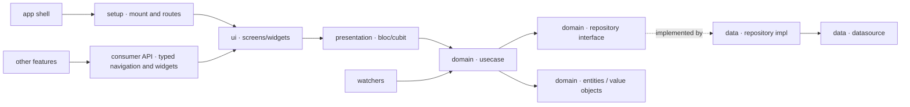

# 🏗 Architecture

This project follows a **feature-based** and **layered architecture** to ensure **separation of concerns**, **scalability** and **maintainability**.

This document describes a **target we move toward, not a finished state.** The codebase is mid-migration and carries legacy that predates these rules — that's expected, and we say so openly (see "How the codebase actually looks today"). We're not chasing a perfect snapshot; we make it **better one iteration at a time.** The rule of thumb: leave every file you touch a little cleaner than you found it and converge it toward the architecture described here — and never replicate legacy just because it's there.

> **New here? Read in this order:** **Feature-Based Architecture** → **How the codebase actually looks today** (the honest snapshot) → **Entry points & code tour** (find your way around the code) → **The architecture we tend toward** (the rules you apply daily). The rest is reference.
>
> **Repo doc map:** [README.md](README.md) = the product · **ARCHITECTURE.md** (this file) = the layer model & design rules · [AGENTS.md](AGENTS.md) = toolchain, commits, naming, the day-to-day contract · [WORKSPACE.md](WORKSPACE.md) = internal dependency graphs · [DEPENDENCIES.md](DEPENDENCIES.md) = direct external dependencies.

**Contents:** Feature-Based Architecture · How the codebase actually looks today · Entry points & code tour · The architecture we tend toward (logic homes · use-cases · repositories · datasources · entity/model · vertical slice · errors · capability API · convergence) · Layer glossary · Feature & package templates (incl. *Adding a feature* checklist) · Monorepo Migration · Rules for AI.

## 📦 Feature-Based Architecture

Features are self-contained modules that encapsulate all code related to a specific functionality, domain, or resource of the application.

A feature is the single owner of its domain, meaning it is solely responsible for enforcing all business rules and domain logic related to that domain. No other feature may directly access or modify a feature’s internal domain models, state, or persistence details.

Other members interact with the feature through its published capability API. The API defines the stable contract, keeps business rules with their owner, and lets the implementation evolve independently of callers.

This approach gives features clear ownership, public boundaries and independent tests. The generated [workspace dependency graphs](WORKSPACE.md) show declared edges; the [workspace dependency rules](#workspace-dependency-rules) explain how those boundaries are enforced.

## 🧭 How the codebase actually looks today

> Honest snapshot (directory census, re-measured 2026-08-25). Read this before assuming the sections below describe what already exists — they describe where we are heading. Numbers are approximate (`≈`), non-normative, and will drift; re-measure with `find`/`grep` rather than trusting this snapshot as it ages.

The codebase has **two coexisting patterns**, which is expected mid-migration:

**1. The dominant pattern — `ui → bloc → usecase → repository → datasource`** (calls flow down; data flows back up). Most shared *data + domain* lives in `lib/core/<domain>/` (28 top-level domains under `lib/core/`, 32 datasource files, 28 repository interfaces under `domain/repositories/`, ≈279 use-case files app-wide — most in `lib/core`, ≈20 features carry their own under `domain/usecases/`). Most *features* in `lib/features/<feature>/` are **presentation + ui** (bloc/cubit files found across ≈38 of 48 feature folders) that consume `lib/core`. The shape: a datasource per external system, an abstract repository with its implementation, use-cases, a bloc on top, `get_it` for wiring. It is simple, uniform, and well understood — **this is the pattern we consolidate on.**

**2. A minority drifted to a heavier hexagonal split (examples: `labels`, `electrum_settings`, `fund_exchange`, `recipients`, `broadcast_signed_tx`).** Extra rings — `application/` (use-cases + ports), `adapters/`, `frameworks/`, `interface_adapters/` — plus per-layer error types and several model+mapper hops. More files, more vocabulary, no extra capability. **We converge these back** onto pattern 1 (see "Convergence" below).

**Legacy feature facades** predate the workspace capability APIs (9 `*_facade.dart` files under `lib/features/` in the 2026-08-25 census). Direct cross-feature imports and separate locator and router entry points also remain in parts of the legacy app.

**Documentation-only PRs still produce the final `CI` status.** The `Analyze and Test` workflow ([analyze_and_test.yml](.github/workflows/analyze_and_test.yml)) runs changed-file classification and the action-pin gate for every PR; docs-only changes skip the heavy application checks and integration job, then the final `CI` job reports success. The repository ruleset is not yet updated to require this status, so it is not mandatory until an administrator activates that requirement.

This split maps almost 1:1 onto the melos target (see Monorepo Migration): `lib/core/<domain>` → `packages/<domain>` (shared data + domain, no UI), `lib/features/<feature>` → `features/<feature>` (presentation + ui). The migration is mostly a **relocation**, not a rewrite.

## 🚪 Entry points & code tour

New to the code? Start at these files — together they are the app's **composition root**. The shell composes modules; it does not implement them (see "The shell composes, modules construct" under Monorepo Migration):

- **`lib/main.dart`** — process entry, delegates to `startApp()` in `lib/bootstrap.dart`.
- **`lib/bootstrap.dart`** — Flutter binding, startup wizard, application rendering and startup/global error handling. `package:wizard/wizard.dart` owns the pre-locator wizard flow and pending consent read.
- **`lib/init.dart`** — ordered service initialization. `Bull.init()` runs before the wallet app's `runApp()`: logging → error reporting (Sentry, consent-gated through the first-run wizard) → Flutter-Rust-Bridge / `bull_sdk` init → `AppLocator.setup()` → wizard flush. `bull_logger.initializeLogging()` owns log setup; `packages/bull_reporting/lib/src/report_logger_adapter.dart` connects its reporting contract to the app's consent-gated `Report`. Native-library initialization lives in `lib/native_libraries.dart`, Tor diagnostic collection in `features/network`, and background-task scheduling in `package:background_tasks/background_tasks.dart`. The foreground and background composition roots share these helpers without importing one another.
- **`lib/app.dart`** — root widget, lifecycle handling and always-on top-level blocs (app-startup, wallet, settings, bitcoin-price, exchange).
- **`lib/locator.dart`** — dependency injection (`get_it`). `AppLocator.setup()` opens capabilities and mounts features alongside legacy core and feature registrations.
- **`lib/router.dart`** — navigation (`GoRouter`). `AppRouter.router` starts at `WalletRoute.walletHome`, wraps the app in a root `ShellRoute`, and assembles route contributions from mounted features and legacy routers.

For the Settings subtree, the shell combines the Settings hub and its child routes with typed destinations from the route owners, including Fees, Swap, Address View, All Seed View and BIP85. Bull Exchange contributes its account and access routes, Backups its backup flows, and Network its diagnostics routes and service status. The shell binds Settings wallet discovery to `OverviewSynchronization`, rather than to the legacy Wallet projection, and supplies Electrum's foreground barrier to Settings before network changes.

Open a package through its published capability and mount a feature through its composition library. To understand a feature, trace it top-down: **route → screen (`ui/`) → bloc (`presentation/`) → use case (`domain/usecases/`) → repository → datasource.** The vertical slice below walks one real example end to end.

Shared infrastructure and shared domain live in `lib/core/<domain>/` (see "Special Note on Core Module"); per-flow UI lives in `lib/features/<feature>/`.

Import, onboarding and app-startup recovery use `package:mnemonic_entry/mnemonic_entry.dart` for typed mnemonic input.

`ImportFeature.mount` owns the import hub, mnemonic entry and confirmation, watch-only scanning and confirmation, and hardware instructions. The mnemonic duplicate check reads the unlocked Secrets inventory for the active Bitcoin network. The shell binds `WalletProvisioning` and the Secrets custody admission port; Provisioning coordinates durable catalog registration with native account creation through Sync.

## 🎯 The architecture we tend toward

One pattern, everywhere: **`ui → bloc → usecase → repository → datasource`.** The vocabulary stays the one the team already uses — `datasource`, `repository`, `usecase`, `bloc` — with **no `port` / `adapter` / `application` / `framework` renaming**.

This is the same spine the **Flutter team's** official [app-architecture guide](https://docs.flutter.dev/app-architecture) *strongly recommends*: a repository-based **data layer** and an MVVM **UI layer** ([recommendations](https://docs.flutter.dev/app-architecture/recommendations)). Our **bloc/cubit plays the ViewModel role** — this mapping is ours; the official docs are state-management-agnostic and never name BLoC. We also adopt its other *strongly recommend* items: **abstract repository classes**, **immutable models**, **unidirectional data flow**, **dependency injection**, **no logic in widgets**, and **fakes for testing**.

### The rule that matters most: where does logic live?

"Too much logic in use-cases" is the symptom of logic sitting in the wrong layer. There are **three homes**, and the fix is to put each kind where it belongs — not to push everything into repositories (that just makes god-repositories):

| Home | What lives here | Litmus test |
|---|---|---|
| **Domain** (entities, value objects) | invariants **intrinsic** to one type, always true | "True regardless of the use-case?" → `Amount` ≥ 0, address format, xpub validity |
| **Repository** | **data** logic for one type: combine datasources, cache, map model↔entity, single source of truth | "Depends on *how we store/fetch* this type?" → "fetch UTXOs by merging Electrum + local DB and map to `Utxo`" |
| **Use-case** | **orchestration**: coordinate multiple repositories, multi-step workflow, flow decisions | "Coordinates several repositories / describes one user goal?" → coin-selection + build PSBT + sign + broadcast |

So: **rich domain models**, **repositories that own data-shaping**, and **thin use-cases that only orchestrate**. A 100-line use-case coordinating several repositories with rollback is fine — that *is* orchestration. A use-case that maps one model to another, or re-checks an invariant the entity already guarantees, is misplaced logic — push it down. This three-way split is the single biggest improvement we are making.

### Use-cases: always present, kept thin

Every call from the UI goes `bloc → usecase → repository`. **A bloc never imports a repository or a datasource directly** — the use-case is the stable, testable seam between presentation and data, and the place where data-layer errors are mapped to feature errors. This uniformity is deliberate: one shape to learn, one shape to review, across all 48 features.

Keeping the use-case *thin* (per the table above) is what prevents the "use-cases are overhead" trap the Flutter team warns about — the overhead is logic with no home, not the seam itself. The Flutter team rates a dedicated domain/use-case layer *Conditional* ("in most apps they add unnecessary overhead", [recommendations](https://docs.flutter.dev/app-architecture/recommendations)); we knowingly accept that small, uniform cost in exchange for one predictable pattern, and we pay it back by keeping use-cases thin.

- **Owns:** coordinating **multiple** repositories/ports, sequencing a multi-step workflow, and **mapping data-layer errors → the feature's `<Feature>Failure`** (when wrapping a shared core repo that still throws; a feature-local repo maps at the repo boundary).
- **Never:** shaping data, re-checking an invariant the entity's constructor already guarantees, or touching a datasource.
- **Smell:** a use-case that imports from `data/`; a use-case that re-validates what the entity already enforces.

The entry method is **`execute(...)`** — the codebase convention (206 of 209 use-cases; not `call`), one public method per use-case. Real example: `GetWalletUtxosUsecase.execute(walletId)`. A one-line use-case that merely forwards to a repository is **fine** — it is the uniform, testable seam where errors get mapped, not dead weight; that uniformity is worth more than saving a file.

### Repositories: abstract interface in `domain/`, implementation in `data/`

The repository is the data **seam** and the single source of truth for one data type ([data-layer](https://docs.flutter.dev/app-architecture/case-study/data-layer)). Declare it as an **`abstract interface class`** so the compiler enforces the contract and implementations can be swapped (regtest / mock / production).

- **Interface (the contract):** `domain/repositories/<noun>_repository.dart` — the single `repositories/` folder. It imports only domain types, so `domain` never depends on `data`. This is the Dependency Inversion Principle: the contract belongs with its consumer, the use-case.
- **Implementation:** `data/<noun>_repository_impl.dart`, next to the datasources it wraps. There is **no second folder named `repositories`**.

> **Source / trade-off.** The Flutter team's case study puts the abstract class *and* its implementations together in `data/repositories/<entity>/` and keeps `domain/` for models only — `BookingRepository` + `BookingRepositoryRemote` + `BookingRepositoryLocal` all in `data/` ([data-layer](https://docs.flutter.dev/app-architecture/case-study/data-layer), folder tree in the [case study](https://docs.flutter.dev/app-architecture/case-study)). We deviate on purpose: because we keep a real use-case layer in `domain/`, the interface lives in `domain/` so the dependency rule holds. It is the same Ports-&-Adapters idea — interface = port, impl = adapter — expressed in our vocabulary and without a duplicate `repositories/` folder.

**The boundary rule — this one never bends.** A repository's **public signatures — returns *and* params — use only domain types**: entities, value objects, `Result<Entity, …>`. Wire models, library types (a BDK `LocalUtxo`, an LWK type, a Drift row), JSON `Map`s and DTOs **never cross the repository boundary** — they live and die inside `data/`. This is *why* entity and model stay separate (see "Entity vs. model" below); it is not abstraction for its own sake.

- **Owns:** combining its datasources, caching, and **mapping wire model ↔ domain entity**; the single source of truth for one type. Real example: Coins resolves a registered wallet as a WalletKey, reads the published CoinList from Sync, and maps each coin to a WalletUtxo with its labels.
- **Never:** orchestrate a user goal across **other repositories**, or sequence a multi-step workflow — that is a use-case.
- **Smell:** a repository importing another repository; a "god repository" of unrelated methods; data-shaping leaking up into a use-case.

### Datasources: one external system each, private to the repository

A `datasource` wraps exactly one external system (Drift, BDK, an Electrum socket, an HTTP API), is stateless, and is a **private member of its repository** — bloc and UI can never reach it directly ([data-layer](https://docs.flutter.dev/app-architecture/case-study/data-layer): *"the service is a private member, so that the UI layer can't bypass the repository"*).

- **Owns:** that one system's calls, returning its **wire/persistence shape** — a `*Model`, a `Map`, or a library type. `BdkWalletDatasource.getUtxos()` returns `WalletUtxoModel`s, never domain `WalletUtxo`s.
- **Never:** combine two systems, decide policy, cache across calls, or map to a domain entity. One datasource never imports another.
- **Smell:** a datasource returning a domain entity; a datasource calling another datasource.

### Entity vs. model: always two, always separated

Every persisted or transferred record has **two** types, kept apart — never one class doing both domain and wire duty. The split exists to serve the repository boundary rule above: the repository hands out **entities**, the datasource speaks the **wire shape**, and the model is that wire shape, which must never escape `data/`.

- **Entity** (`domain/entities/`) — what the app reasons about. **Rich and self-validating: an invalid instance must be impossible to construct.** Enforce invariants in the constructor — with freezed, in a **factory** that validates then delegates to the private `._()` constructor, or by composing validated **value objects** (`Amount`, `Address`, fee rate). It carries behavior and getters (e.g. `WalletUtxo.address` resolves per sealed variant). It has **no** `fromJson`/`toJson`, **no** Drift annotations, and **no** awareness of how it is stored.
- **Model** (`data/models/`) — the wire/persistence shape. Mirrors the external/stored structure (a JSON envelope, a Drift row, a BDK/LWK library type). **Pure data: serialization only** (freezed `fromJson`/`toJson`, Drift) — no business rules, no validation beyond parsing.
- **Mapper** (`data/mappers/`) — the one place the two meet; translates model ↔ entity. Its own **file** once it earns one (rule #14 in AGENTS.md), an extension or inline mapping when it is trivial.

**Why two even when they look identical:** they change for **different reasons**. The model changes when the API or DB schema changes; the entity changes when the domain rules change. Fuse them and a renamed JSON field ripples into domain logic, or a domain invariant leaks into serialization. The Flutter team rates separate models *Conditional* ("adds verbosity… use in large apps", [recommendations](https://docs.flutter.dev/app-architecture/recommendations)) — **we deliberately make it mandatory**: in a self-custodial wallet the wire/DB shape and the domain shape must stay free to diverge safely. The cost is one mapper; the payoff is each side has exactly one reason to change.

**This is not over-abstraction.** Over-abstraction is *extra layers* — a repository **and** datasource for trivial CRUD, a mapper *file* for a one-line map, a request/response-DTO explosion. The entity/model split is the one boundary you never collapse. The cap stays **two types per record** (entity + wire model); the five-types-per-record shape (entity / value-object / primitive / request-DTO / response-DTO + a mapper between each) is the verbosity to collapse. Value objects are for correctness-critical primitives — amount/sats, address, fee rate — not every field.

Coins illustrates this boundary. The incoming record is Sync's Coin. WalletUtxoMapper combines it with the application's labels to produce a WalletUtxo for display.

The app imports `ConvertAmount` and `FormatAmount` from `primitives`. Amount formatting uses Intl without a Flutter dependency.

**An entity that cannot hold a bad value** (illustrative — shared value objects belong in `packages/primitives`):

```dart
class Amount {
  final BigInt sats;
  Amount(this.sats) {
    if (sats < BigInt.zero) throw ArgumentError('Amount cannot be negative');
  }
}
// A freezed entity validates in a factory, then delegates to the private ._() constructor.
```

### A vertical slice, end to end

How the layers hand off on a real read — fetching a wallet's UTXOs:

```
ui  ── user opens a screen that lists coins
 └─ bloc       e.g. SendCubit / SellBloc   holds List<WalletUtxo> in state; no logic
     └─ usecase  GetWalletUtxosUsecase.execute(walletId)
                  coordinates, maps failures → WalletFailure
         └─ repo  WalletUtxoRepository.getWalletUtxos(walletId)     [interface: domain/]
             │     impl merges datasources, maps model → entity     [impl: data/]
             ├─ datasource  WalletMetadataDatasource              → WalletMetadataModel
             ├─ datasource  BdkWalletDatasource / LwkWalletDatasource → WalletUtxoModel
             └─ datasource  SyncFreezesDatasource                 → frozen outpoints (sync)
```

Calls flow **down**; data flows **up**, transformed once per boundary: **wire model** (datasource) → **domain entity** (repository) → **UI state** (bloc). Each downward arrow is a call into a narrower contract; each upward return crosses exactly one boundary and changes type exactly once. The bloc never sees a `*Model`; the datasource never sees an entity.

### Error handling

Three words, three jobs, kept strictly apart: **`Exception`** = thrown, low-level, recoverable (data layer, caught at the boundary); **`Error`** = a `dart:core` programmer bug, never caught (crashes → Sentry); **`Failure`** = a modeled, recoverable **value** that lives in `domain/` and is the only error kind the UI ever sees. `Error` is **never** a domain type — name domain failures `<Feature>Failure`, never `<Feature>Error`.

- **One sealed public `Failure` family per member.** In a feature, define it in `domain/<feature>_failure.dart` (`sealed class <Feature>Failure extends Failure`), **Flutter-free**. Extend the shared `Failure` base in `package:primitives/primitives.dart`; most features aren't deep enough to justify a family per layer. Legacy `BullException` is isolated in `package:primitives/legacy_exceptions.dart`. Map foreign errors at the boundary; never leak another layer's or feature's type.
- **Translation lives in presentation, not on the failure.** Because the repository (data layer) constructs the failure, the failure type must stay Flutter-free — so `toTranslated(BuildContext)` is a **presentation-layer extension** (`presentation/<feature>_failure_l10n.dart`), the only place that imports `flutter` / `context.loc`. The `sealed` switch in the extension still makes a missing user message a compile error. **The end user never sees a dev string:** the catch-all variant returns a **generic** localized message (`context.loc.oopsSomethingWentWrong`), never the raw `logMessage` — that text is logged at the boundary and is for us only. (`unexpected: (message) => message` leaks dev detail; the anti-pattern to avoid.)
- **`Result<T, F extends Failure>` at the boundary** for expected, recoverable failures (variants `Ok` / `Err`; `throw` only for `dart:core`-style programmer bugs). Dart exceptions are unchecked — callers aren't forced to handle them ([dart.dev](https://dart.dev/language/error-handling)) — so a `Result` makes failure explicit in the signature ([Flutter Result](https://docs.flutter.dev/app-architecture/design-patterns/result)). Generic over `F` so consumers never cast; annotate returning methods `@useResult`; helpers `fold` / `map` / `mapErr`.
- **The flow, end to end.** The **repository** is the one `try/catch`: it catches the foreign `Exception`, logs the raw reason, maps it to the feature's `<Feature>Failure`, and returns `Result<T, F>`. *(When a feature wraps a shared **core** repo that still throws, this mapping moves up to the feature's **use-case** — the first layer the feature owns.)* The **use-case** forwards or composes `Result`s (no `try/catch`). The **bloc** consumes with an exhaustive `switch`, storing the typed `<Feature>Failure` in state — no cast, no `BuildContext`. The **UI** renders `failure.toTranslated(context)`. A domain `Failure` in the bloc is correct (presentation → domain), not a leak; the leak prevented is a *data* exception crossing the boundary.

> **Migration (#1895).** Sanitizing user-facing errors to this standard is a **sanctioned, staged migration** (issue #1895), not opportunistic. Existing features still using `BullException`, `<Feature>Error` naming, `toTranslated` *on* the error, or `throw`-based propagation are **legacy-to-converge** — don't replicate them; bring a feature fully in line when you touch it, one feature per PR.

### The capability API: a member's public contract

A member owns its capability, domain types, and failure family. Consumers import its entry library and call the capability directly from their own use cases. The API carries domain values belonging to that contract and keeps persistence models, wire formats, internal state management and orchestration private.

- **Package.** A stateful package opens through one `X.open(...)` entry point. [`GoogleDrive.open`](packages/google_drive/lib/src/google_drive.dart) and [`Electrum.open`](packages/electrum/lib/src/electrum.dart) show synchronous construction. [`Labels`](packages/labels/lib/labels.dart) opens with `Labels.open` and exposes a single typed query, `fetch({reference})`, for all labels or a reference-scoped read. An empty match is `Ok([])` and a storage failure is `Err`.
- **Feature.** One `XFeature.mount(...)` constructs the feature and contributes its routes to the shell. [`SignersFeature.mount`](features/signers/lib/src/signers_feature.dart) exposes its routes via the [composition library](features/signers/lib/routes.dart), while [`signers.dart`](features/signers/lib/signers.dart) gives callers typed navigation. A feature may also publish reusable widgets. Its blocs and cubits stay private.
- **Operations.** Public fallible commands and queries return `Future<Result<T, XFailure>>` with one sealed public failure root per member. Map internal and cross-member failures at the boundary. Fallible observations use `Stream<Result<T, XFailure>>` or an owned state that already models failure. Preserve natural return types for pure helpers, domain values and typed navigation, including existing navigation cancellation and in-flow error handling. Construction and cleanup keep their natural sync or async signatures and return typed failures when they can fail recoverably.

The narrower capability surfaces of [`secrets`](packages/secrets/lib/secrets.dart) and [`sync`](packages/sync/lib/sync.dart) illustrate operation ownership: a `Secret` handle groups derivation and signing, and a `Wallet` handle observes wallet state. Their existing lifecycle entry points predate the `open` convention.

### Convergence (the ≈6 hexagonal modules)

Map the heavier vocabulary back onto the consolidated one — opportunistically, never a big-bang, never in an unrelated PR:

| Hexagonal (today) | Consolidated (target) |
|---|---|
| `application/usecases/` | `domain/usecases/` |
| `application/` ports | `domain/repositories/` (or `domain/` for non-repo ports) |
| `adapters/` (repo impls) | `data/<noun>_repository_impl.dart` |
| `frameworks/` (datasources, drivers) | `data/datasources/` |
| `interface_adapters/` | `presentation/` + `ui/` |

What is deprecated is the hexagonal **folders** above, not the word "port". Both a repository and a non-repository port are `abstract` domain interfaces living in `domain/` with their implementation in `data/`, and in Ports-&-Adapters terms a repository *is* a port. The convention splits them by **what they abstract**:

- A **repository** owns a **data type**: it is the single source of truth for one entity, shaped around fetch / persist / cache and model↔entity mapping. *Litmus: "does it store and retrieve a domain entity?"* Name it `<Noun>Repository` (never `<Noun>Port`).
- A **non-repository port** abstracts a **capability** — an action or external service with no entity ownership and no source-of-truth role. *Litmus: "is it a verb/service rather than a data type I own?"* Examples in the codebase: `BlockchainPort.broadcastLiquidTransaction`, `ElectrumConnectivityPort.checkServersInUseAreOnline`, `SocketPort.connect`. Keep the `Port` suffix and name it `<Capability>Port`.

The repository's own interface is the canonical port (the Ports-&-Adapters analogy in "Repositories" above); we just give it the `<Noun>Repository` name. Reach for a `Port` only when no entity is being owned — otherwise it is a repository.

## 🗂️ Layer glossary (our terms)

- `domain/entities/` — entities and value objects; **rich** models that enforce their own invariants in the constructor/factory (an invalid instance can't exist), never anemic DB mirrors. Never carry serialization — that's the model's job.
- `domain/repositories/` — the **abstract** repository interfaces (the contracts use-cases depend on).
- `domain/usecases/` — one per user intent; **thin orchestration** only.
- `domain/<feature>_failure.dart` — the feature's sealed `Failure` family (Flutter-free); its `toTranslated(context)` lives in a `presentation/<feature>_failure_l10n.dart` extension, never on the failure itself.
- `data/datasources/` — stateless wrappers around one external system each; private to their repository.
- `data/<noun>_repository_impl.dart` — the concrete repository implementation.
- `data/models/` — the wire/persistence model, one per entity, always separate from the domain entity (serialization only). `data/mappers/` — model ↔ entity; a file only once it earns one (rule #14), inline/extension when trivial.
- `presentation/` — bloc/cubit + state + event. The ViewModel: holds UI state, exposes intents, calls use-cases. Thin — no business decisions.
- `ui/` — screens + widgets; depend on the bloc only.
- `lib/<member>.dart` — the member's consumer entry library. Capability implementations live under `lib/src/` and can use an internal `public/` directory.
- `watchers/` — optional event listeners that drive use-cases (never repositories directly).

## 🧩 Feature & package templates

**Canonical feature (self-contained, owns its data):**

```
features/<feature>/lib/
  <feature>.dart      # consumer entry library
  setup.dart          # mount and route contribution
  src/
    domain/
      entities/       # (+ value objects) — rich models
      repositories/   # abstract interfaces (the contracts)
      usecases/       # one per intent, thin orchestration
      <feature>_failure.dart
    data/
      datasources/    # one external system each, private to the repo
      models/         # wire/persistence model, separate from the entity
      mappers/        # model ↔ entity (a file only once it earns one)
      <noun>_repository_impl.dart
    presentation/     # bloc/cubit, state, events and failure translation
    ui/
      screens/
      widgets/
    <feature>_feature.dart
```

The canonical flow, end to end:



A feature whose data is **shared** does not hold `domain/` + `data/` itself — it consumes a package (below). A feature with **private** data keeps the full stack. The dividing line is one question: *is this data used by more than one feature?*

### Adding a feature: the checklist

For a new user-facing flow in `features/<feature>/`, working **outside-in is fine but design domain-first**:

1. **Domain.** Rich entity + value objects (`domain/entities/`), the `abstract interface class <Noun>Repository` (`domain/repositories/`), the sealed `<feature>_failure.dart` (`<Feature>Failure extends Failure`, Flutter-free — translation comes later as a presentation extension), and one `<Verb><Noun>Usecase` per intent (entry method `execute(...)`).
2. **Data.** Datasource(s) (`data/datasources/`, one external system each), wire model + mapper (`data/models/`, `data/mappers/`), and `<noun>_repository_impl.dart`. The repository returns entities only — never a model (see "boundary rule").
3. **Presentation.** `<Feature>Bloc`/`Cubit` + sealed state/event, plus the `<feature>_failure_l10n.dart` extension exposing `toTranslated(BuildContext)` (`presentation/`). The bloc stores the `<Feature>Failure` in state; it calls use-cases only — never a repository or datasource.
4. **UI.** Place screens and widgets in `ui/`. Reuse the `bull_ui` public components, localize strings via `context.loc.<key>` and take colors from the theme (see AGENTS.md "UI Kit").
5. **Wire it in.** Call `<Feature>Feature.mount(...)` from the shell and add the returned routes in `lib/router.dart`. The mount owns construction and registration of feature internals.
6. **Publish the consumer contract.** Export typed navigation, any reusable widgets and the owned domain types those APIs use through `lib/<feature>.dart`. Regenerate the dependency docs when declarations change; explain non-obvious dependencies in the consuming member's README.
7. **Generate & test.** `make build-runner` (freezed/drift/json codegen); unit-test every use-case and entity-with-rules (`make unit-test`); add l10n keys and run `make translations`.

**Package (shared foundation — `packages/<name>`):** the `domain/` + `data/` half of the same shape. Its entry library (`lib/<name>.dart`) exports the capability, owned domain values and typed failures. Implementations stay under `lib/src/`. A package that owns a sealed UI component can publish it where the capability requires it (see "Sealed UI" under Monorepo Migration).

### Enforcing the rules (turn conventions into compile/lint errors)

| Rule | Lever |
|---|---|
| Repository is a contract | `abstract interface class <Noun>Repository` (Dart class modifiers) — the compiler forbids `extends`, forces `implements` |
| Exhaustive failure/state handling | `sealed class <Feature>Failure` / sealed states — a missing `switch` case is a compile error |
| A returned `Result` must be handled | `@useResult` (`package:meta`) on repo methods — the analyzer warns if the result is discarded |
| Published entry libraries | melos package boundaries + the `implementation_imports` lint (a package's `src/` is unreachable from outside); an analyzer-plugin or `custom_lint` rule for in-`lib/` features |
| Bloc never imports `data/` | an analyzer-plugin or `custom_lint` rule banning `data/` imports from `presentation/` + `ui/` |
| Lock a contract's capabilities | `@Deprecated.implement()` / `.instantiate()` / `.extend()` on a base class (Dart 3.10+) — analyzer warns on the forbidden capability |
| Whole-project gate | `analysis_options.yaml` + `flutter analyze --fatal-infos` in CI and the pre-commit hook |

The pairing that does the heavy lifting: **`abstract interface class` + `sealed` + `@useResult` + a layering lint + melos boundaries** — all available in the current toolchain (Flutter 3.41/3.44 bundle Dart 3.11/3.12), none requiring a specific point release. Two of these landed in **Dart 3.10** and are simply available to us now: the first-party **analyzer plugin system** — author a layering rule (e.g. ban `data/` imports from `presentation/`) that also ships IDE quick-fixes, the supported successor to third-party `custom_lint`; and fine-grained **`@Deprecated.*`** capability annotations to lock a contract (implementable but not extendable, etc.). Nothing in 3.41/3.44 itself is *required* — they introduce no new architecture-enforcement capability beyond what 3.10 already gave us.

### Special Note on Core Module

`/lib/core` is a shared technical module of low-level primitives/drivers/helpers, not the "core" business logic; it must stay independent of any feature-specific logic. Historically `lib/core` also accreted shared *domain* modules (e.g. `wallet`, `secrets`) — those are exactly what graduate into `packages/<domain>` under the melos migration. What remains in `lib/core` stays infrastructure-only.

## 🔺 Common Architectural Pitfalls

While the architecture described above represents our current standards, the codebase contains legacy code that predates these principles. We're actively refactoring to align with these standards. When working in the codebase, watch out for—and avoid replicating—these common anti-patterns:

**Breaking Feature Boundaries**

- **Problem**: Features directly import usecases, domain models, repositories, or services from other features
- **Impact**: Creates tight coupling, bypasses business rules, and leads to circular dependencies
- **Solution**: Call the owning member through its published capability API

**Business Logic in Presentation Layer**

- **Problem**: BLoCs/Cubits contain orchestration logic, decision-making, or complex transformations that belong in use cases
- **Impact**: Makes business logic untestable in isolation, duplicates logic across features, and indicates poorly defined or too coarse-grained use cases
- **Root Cause**: Often happens when directly using other features' use cases instead of creating feature-specific orchestration
- **Solution**: Keep BLoCs thin—they should only transform between UI state and use-case calls; a BLoC never calls a repository or datasource directly

**Bypassing the use-case layer**

- **Problem**: Watchers (or other UI-side drivers) invoke repositories directly, creating flows like `watcher → repository → datasource` that skip the use-case seam
- **Impact**: Business rules and error-mapping that belong in the use-case get bypassed
- **Example**: Payjoin and swap datasources managing event streams with watchers listening directly
- **Solution**: Watchers invoke use-cases, which then use repositories: `watcher → use-case → repository`

**Core Module Bloat**

- **Problem**: Feature-specific business logic placed in `/core`
- **Impact**: Creates implicit coupling and makes core non-reusable across projects
- **Solution**: Keep core limited to generic primitives, low level drivers, and infrastructure helpers with no business logic

**Anemic Domain Models**

- **Problem**: Entities defined as simple data containers (DTOs) that mirror database schemas without encapsulating business rules
- **Impact**: Business logic scatters into services/use cases instead of living in the domain where it belongs
- **Solution**: Entities should encapsulate business rules and be independent of persistence concerns

**Over-Abstraction (repository + datasource for trivial CRUD)**

- **Problem**: Unnecessary layers (e.g., both repository AND datasource for simple CRUD operations)
- **Impact**: Adds complexity and indirection without meaningful benefit
- **Solution**: Use a single repository if there's no meaningful transformation or clear logic to separate

**State Management Confusion**

- **Problem**: Mixing ephemeral widget state with BLoC state
- **Impact**: Makes state management unpredictable and harder to test
- **Solution**: Use local widget state (StatefulWidget) for UI-only concerns; use BLoC only for business state

## 📦 Monorepo Migration (melos workspace)

The codebase is migrating, incrementally, from a single Flutter package to a [melos](https://melos.invertase.dev/) pub-workspace. This is an organizational change layered on top of the architecture above — it does not alter the feature-based / layered rules, it gives them a stronger, compile-time boundary.

**Current state.** The app remains at the repo root and is declared as a workspace package through `useRootAsPackage: true`. The root `pubspec.yaml` `workspace:` key lists 43 members (checked 2026-11-22): `features/ark` owns the Ark journeys, `packages/ark` owns the Ark protocol and native lifecycle, `packages/secrets` owns custody of secret material and encrypted database opening, `packages/legacy_storage` owns the historical application database and shared encrypted database import, `packages/bull_ui` owns the design system, `packages/bull_ui_catalogue` is its dev-only Widgetbook, `packages/primitives` owns shared pure-Dart value types and results, `packages/bull_payjoin` owns the pure-Dart Payjoin contract, engine, and persistence, the Flutter-dependent `packages/bull_tor` owns embedded Tor, `packages/mempool` owns explorer links, server configuration and validation, `packages/screen_privacy` owns screenshot/recording-capture blocking, `packages/bull_logger` owns logging and diagnostic infrastructure, `packages/bull_reporting` owns consent-gated reporting and its logger bridge, `packages/sync` owns native-store writes, Electrum sync and wallet-independent transaction review values (`package:sync/transactions.dart`), `packages/background_tasks` owns headless task scheduling and dispatch, `packages/notifications` owns notification delivery and its outbox, `packages/bull_pricer` owns the public Bitcoin index price and its history in its own SQLite database, `features/btc_map` owns the BTC Map feature (`btc_map`): merchant sync, disposable cache, domain, MapLibre view, screen, list, search, cubit and translations, `packages/screen_awake` owns screen wake-lock control, `packages/novlang` owns the store-constrained vocabulary (the platform/superuser policy and the override catalogues for the words a store forces; the root catalogue keeps the real words), `features/logs` owns the user-facing diagnostic log viewer, `features/quick_actions` owns the wallet quick action selection and presentation, `features/recoverbull` owns the RecoverBull backup and recovery UI, `features/signers` owns hardware discovery, public account reading, signing, address verification, URQR and PSBT handoff with its own translations and `SignersFeature.mount`. The root supplies the NFC writer and assembles the contributed routes, `packages/rust_bindings` owns the app's Rust bindings (Boltz, LWK, BWK, BBQR, BitBox, verify_tx) behind one flutter_rust_bridge library, `packages/onion` owns the embedded Arti client and its Snowflake transport, `packages/boltz_stream` owns the Boltz swap status socket, `packages/bitbox_transport` owns the BitBox02 USB and Bluetooth transport, and `packages/satoshifier` owns payment-request and address parsing. Those five native and transport members came from the bull_sdk repository on 2026-11-17. The pure-Dart `packages/bbx_api` provides the Bull Bitcoin exchange capability. `Bbx.open` constructs its authenticated HTTP groups and notification socket, whose operations publish typed values in `Result`s. Wire JSON, protocol exceptions and foreign transports stay internal. App-side adapters supply the credential reader and map capability values to feature domain types. The `features/network` member owns the Electrum, Mempool and Tor settings screens and service status, including translations. Its single foreground entry point, `NetworkFeature.mount`, contributes root routes and the Tor route nested under app settings. It calls the protocol owners, Preferences and Fees directly. Host bindings supply the default wallet environment and the wallet Tor requirement. Status consumers own independent Result-returning sessions, and startup Tor diagnostics are exposed through `package:network/setup.dart`.

`packages/exchange` owns account, order, DCA and default payout values, the shared order-deadline scheduler and their exchange operations. `Exchange.open` provides a strict account-level pending-order scan over an authoritative session snapshot, and typed operations for account reads and preferences, announcements, order statistics and KYC uploads. Buy, Sell, Pay, Withdraw, DCA and Transaction History use `Exchange.orders(environment)`; order requests do not cross session environments and history without a stored session remains distinct from a credential read failure. Default-wallet operations use the same session boundary. Exchange Settings owns document selection and validation. BBX decoding remains in the transport; the ordinary Exchange library does not expose wire values, codecs or repositories. The app's existing access coordinator receives legacy credential lifecycle through `package:exchange/setup.dart`; `secrets` still owns the underlying keychain.

The Exchange credential participant owns a separate encrypted schema. It uses the scoped Secrets database worker opener with native-close admission and reads the two fixed legacy records on the foreground isolate. It is not yet active in app composition. Activation requires the coordinator's pre-marker provenance check and draining both legacy credential writers.

`BullExchangeFeature.mount` contributes the exchange landing, authentication, support chat and account settings routes from `features/bull_exchange`. The feature owns the landing copy and sign-in navigation, and the shell supplies branding, store vocabulary policy and the exit destination. The workspace feature owns the authentication WebView and its return paths, chat and settings presentation, attachment handling and localized copy. `Exchange.authenticateWebSession` binds credential generation to the configured environment and view lifetime without returning key material to the feature.

`WizardFeature.mount` contributes no wallet routes: the wizard renders its own localized app before `Bull.init`, using the shared brand images supplied by bootstrap. It receives the platform visibility decision before any services are opened. `packages/exchange` owns that pure decision independently of the later exchange access state, and `bull_exchange` renders the option without opening a session. KYC configuration also belongs to `Exchange`; the feature opens the web view with configuration for the active environment only.

`BullExchangeFeature.mount` also contributes the manage-access route under app settings and owns its route-scoped state. `packages/exchange` owns the foreground access queue, epoch, and sign-out journal. The host only binds the existing platform preference, cookie cleanup and app navigation; the Wizard applies its pending choice to the same authority through `Exchange.applyInitialChoice`.

The workspace Settings screen owns the logout and deletion confirmations. `Exchange` observes the access authority for Quick Actions and will not sign out a new session when an older deletion request completes.

Exchange persists the installation-wide enabled and sign-out-pending flags separately from environment-scoped credentials. A current server 401 expires the captured environment without disabling Exchange. Explicit sign-out journals cleanup, attempts both credential and cookie removal, and does not let an unreadable preference block Reset. A pending wizard choice cannot override a later explicit decision. Platform restrictions can hide activation and trading independently of support and authenticated account management.

The same mount contributes the Funding routes at their original router level. Funding reads its account summary and Confidential SEPA availability directly from `Exchange` and uses the workspace virtual IBAN screen. The Exchange domain owns fiat recipients, the CAD directory, SINPE and SEPA activation. Their operations use the untimed BBX client bound to the current session; the feature owns polling, selection and form state.

Buy and DCA mount at their existing root routes in `bull_exchange`. They use the admitted Secrets wallet inventory on the active network and Sync for durable receive addresses. Buy reuses the current receive address; on-chain DCA advances the index for the sole configured default on the selected chain. Lightning DCA does not query the wallet inventory. The host binds the existing destination field, wallet polling, and order history navigation.

Withdrawal is mounted in the same feature and reuses its recipient selection and activation. A completed withdrawal is not invalidated by failing to update Interac defaults. The host opens the existing transaction detail route and preserves its return to Exchange.

The Exchange amount and currency controls are intentionally reusable widgets. DCA, Withdrawal, Sell, Pay and Limit Orders use them within `bull_exchange`. The app supplies the shared destination input for Limit Orders; the feature reads authorized wallets and their latest receive addresses without issuing a new address.

Sell and Pay mount at their original root routes. Exchange owns order reads and writes, Secrets and Sync check the selected local wallet's exact key, and Sync supplies non-issuing fee-estimation addresses and the current unspent coins to the Coins selection sheet. Spend retains the reviewed preparation through estimation, signing and broadcast. Its Payjoin integration signs that same preparation and admits the session with its persistence callback; only Payjoin publishes the payment after admission.

Default payout editing is mounted under Settings and reused by AutoBuy. The editor owns its state and calls `Exchange` for account mutations; until wallet destination input is extracted, the host supplies its shared validation, scanner and viewer.

The Exchange mount contributes `/auto-buy`; the dashboard uses its reusable AutoBuy card. Both use route- or widget-scoped state and call `Exchange` directly for typed account reads, default payout checks and preference writes. The host supplies the existing address viewer and terms URL.

The Exchange mount owns the Trade dashboard and its KYC child route. `ExchangeSessionScope` owns the foreground account state and app-resume refresh. It consumes the Exchange session's guarded account, preference and notification operations; application-level destinations remain explicit navigation callbacks.

The same mount owns the active limit-order card, details, creation and cancellation. Creation uses the admitted Secrets inventory on the selected network, reads the current receive address through Sync without advancing it, and leaves configured Exchange destinations available when local inventory is unavailable.

`packages/file_system` owns document selection, bounded reads and saving bytes through the platform picker. `const FileSystem.open()` exposes these operations as typed results. Picker cancellation yields `Ok(null)` for selection and `Ok(false)` for saving. RecoverBull parses vaults, Exchange Settings validates KYC documents, Transactions formats CSV and Labels owns the BIP329 import and export policy.

`packages/google_drive` owns Google sign-in and listing, reading, writing and deleting files in the app data folder. `packages/backup_storage` wraps it behind account-bound byte sessions and owns the Folder and iCloud storage plugins. RecoverBull uses those sessions and still owns the vault format and account-scoped vault selection.

`features/backup_metadata` owns metadata backup grouping, the encrypted local journal (partitioned by view), retention, the BIP138 codec and restore presentation. Secrets supplies a foreground projection with public Bitcoin descriptors only (seed-backed and watch-only accounts) and the restore capabilities: matching a public wallet by network and descriptors, and a monotone, all-or-nothing merge of the BIP85 registry. Labels owns transactional capture and restore and checks freezes against their exact wallet. The feature is off by default, runs in the foreground only and never reads a seed; a file is readable by anyone who knows one of its public descriptors. See [features/backup_metadata/README.md](features/backup_metadata/README.md).

**Fees package (`packages/fees`) and Fees feature (`features/fees`).** `Fees.open` publishes typed estimates for Bitcoin and Liquid. It uses the sync wallet connection port for Electrum and the Mempool capability for fee endpoint selection. The `fees_feature` member owns the reusable fee picker, preview widgets and the fee source settings route contributed by `FeesFeature.mount`. `Fees` owns the preference key and typed reads and writes, using the host preferences store. Fee-consuming use cases resolve the network from the selected wallet or configured environment and call `Fees.estimate` directly. Network status explicitly requests the Mempool source. `Fees.payjoin` supplies Payjoin's receiver fee estimation port and converts an unavailable estimate into the exception that triggers Payjoin's fallback. The feature owns its picker labels in all supported locales and supplies the default amount formatting.

**Target layout.** As modules are extracted (one at a time, never a big-bang), they become pub-workspace members:

- **root = the app shell** — composition only: entry points, ordered bootstrap and lifecycle, app-level navigation, capability selection and calls to each module's published entry point. It ships no domain, data or UI of its own.
- **`features/`** — Flutter packages, one per user-facing flow (`send`, `receive`, `buy`, `sell`, `recoverbull`, …). Each owns its domain and mounts into the shell with its route contribution. A feature may carry an `example/` mini-app to run it in isolation during development; the shipped artifact is the shell embedding the feature, not a standalone app.
- **`packages/`** — app-internal foundation and infrastructure consumed by features. Packages stay pure Dart by default (`storage`, `electrum`, `blockchain`, …), but may depend on Flutter when encapsulating an inherently Flutter/platform capability (`bull_tor`), when owning a sealed UI component (see "Sealed UI" below), or when implementing the shared **design-system package** (`bull_ui`, see "Design-system package" below). A Flutter dependency must serve the package's encapsulated capability; it is not permission to add feature presentation or screens.

**End state: the shell, `features/` and `packages/`.** The wallet is the composition of members, each owning one concept, so no member is named `wallet`. Omit `bull_` from new member names. The exchange feature is `bull_exchange`, alongside the `exchange` domain package. `lib/core` moves into `packages/` and `lib/features` into `features/`; the migration ends when both are empty and deleted, leaving `lib/` with the shell only (routing, DI wiring, composition).

### Workspace dependency rules

Dependencies stay acyclic and point from shell to features and packages, from a feature to other features' public capabilities or packages, and from a package to other packages. Packages never depend on features. Inside a member, the [layer rules](#-the-architecture-we-tend-toward) apply independently of what its manifest declares.

`fvm dart run melos list --cycles` checks declared workspace dependencies. Successful Pub resolution alone does not rule out cycles. The `implementation_imports` lint guards access to another member's `src/`. A declared edge is not evidence that all source imports use the public API. The [foreground dependency test](test/architecture/foreground_sync_dependencies_test.dart) follows imports and transitive exports, including public barrels, to reject new feature edges against the reviewed baseline. Existing legacy source edges remain subject to the reviewed baseline while their owners are extracted. The [shell import test](test/architecture/shell_imports_test.dart) independently guards app composition imports.

`make workspace-graph` reads the manifests to write [WORKSPACE.md](WORKSPACE.md) and [DEPENDENCIES.md](DEPENDENCIES.md); `make workspace-graph-check` checks them locally and in CI. Legacy app source edges are intentionally not duplicated in those documents. Document the reason for a non-obvious edge in the consuming member's README, not in the generated diagram.

**`lib/core` disappears.** It is the legacy home of what becomes `packages/`. No change adds code to `lib/core`, neither logic nor wiring: a change that needs to touch a `lib/core` domain extracts the part it touches into its package (or feature), so its `lib/core` diff is net negative. The shell calls the package's entry point from composition (`lib/locator.dart`, `lib/bootstrap.dart`), and the package wires its own internals.

**Wallet readers.** Sync owns the native lifecycle and publishes balances, address usage, history, coins and spend operations on a wallet handle. Electrum projects reachability from typed Sync completions; wallet refresh callers still receive completions that do not indicate a server failure. The native wallet-values adapter is published by Sync's storage library. Secrets owns the admitted wallet inventory and exact registrations. `OverviewCatalogue` joins those registrations to Sync's native values for Home and the selected-wallet detail, preserving admission, selection and revocation semantics; the Overview controllers own refresh state and per-wallet races without exposing a second aggregate wallet repository. Address View attaches address labels, Coins attaches outpoint, transaction and address labels, and Transactions owns its history projection and transaction status localization. Send owns payment preparation and the follow-up to guarded broadcasts. Native identity is carried as a `WalletKey`, including the concrete network.

`CoinsFeature.mount` contributes `/coins` and constructs its route state. Coins publishes typed coin, summary and global freeze reads; it enriches Sync's wallet coins with Labels and never interprets an unavailable freeze read as empty. The host supplies Secrets inventory, the native Sync wallet loader and revision stream, Electrum foreground signals and Overview's coordinated refresh; it binds Send and Sweep using the original wallet route argument.

`SendFeature.mount` contributes the existing signed-transaction reader, Liquid consolidation and Bitcoin fee-replacement routes. It calls Spend for signing verification, guarded broadcast, replacement and consolidation, and owns its translation catalogue. The host supplies home navigation, the success image and Overview's admitted balance selector for consolidation review. The member also owns the main send route identifier, PSBT handoff, single-recipient payment views and fiat quotes (`Send.open`). The app mounts `/send` and binds Secrets inventory, native Sync reads and synchronization, Electrum completions and Coins projections; the feature owns route state and input revalidation.

**Boltz swaps.** `Swaps.open` composes one stable engine over the admitted canonical and regtest databases. The package owns server selection, resolver replacement, Electrum and chain integration, autoswap settings and the exact lockup payout check. Storage paths, schema and the historical server preference keys are unchanged. `SwapEngineSetup` binds Secrets inventory, Address View and Transactions to the package for wallet choice, fresh receive addresses and transaction history. Swap key derivation remains in Secrets and is requested by the package using the default Bitcoin wallet's fingerprint.

**Swap and AutoSwap.** The `swap_feature` member mounts the transfer routes and the standalone and nested settings routes. It reads exact-network registrations from Secrets, native values and admission from Sync, and uses Spend for preparation, signing and broadcast. The existing public Exchange-order database and transport are owned by `packages/swaps`. The feature applies transaction labels and schedules order refresh through the existing foreground queue. Signed lockups are recorded before submitting to the network, and the pending record remains available to the resolver after an uncertain submission.

**Dated security exception (2026-11): frozen-input broadcast guard.** The guard introduced on develop now lives in the send feature and protects imported and airgap Bitcoin broadcasts as well as wallet sends. The rule #7 exception for adding it to lib/core has ended. Its legacy exception-based contract (rule #11) remains until the shared broadcast API returns the feature's failure family; typed broadcast categories do not by themselves complete that migration. Payjoin broadcasts through its own adapter and is not covered.

**The shell composes, modules construct.** Each stateful package opens and each feature mounts through one entry point. The member owns the construction of its internals: DI registrations, persistence mapping, native resources, error policy, disposal and the unwinding of a partial start. The shell never registers a module's private datasources or rebuilds its repository graph; it passes configuration, callbacks and lifecycle facts. Storage queries, mapping, grouping, wallet/signing/sync policy, recoverable error translation, presentation and strings belong to their owning module, never to a root file. A port does not imply a shell adapter: the implementation lives in the module that may depend on both sides (`bull_payjoin`'s `PayjoinTransactionPort` belongs in the transactions feature, which already consumes `bull_payjoin`; a package never imports the app). A root adapter is exceptional: it names the concrete cycle it breaks and its removal condition, and only forwards public capabilities. Payjoin setup and host bridges now belong to transactions and labels; recoverable lifecycle and storage identity belong to `bull_payjoin`; consent-gated reporting and its logger bridge belong to `bull_reporting`. Wizard startup, Tor diagnostic mapping, the app BLoC observer, foreground sync outcome translation and headless wallet assembly are published by their respective feature owners.

**Wallet reads for network status.** Network selects the default environment through the admitted Secrets inventory and reads the historical mainnet Bitcoin backup time from RecoverBull. The status use cases own unavailable and no-default outcomes.

**Remaining shell import debt.** Legacy feature imports of root `locator.dart` and `router.dart` remain enumerated by `test/architecture/shell_imports_test.dart`; no new exceptions are allowed. The background callback is `backgroundTasksHandler` in `lib/background_entrypoint.dart`; it does not construct a module graph. The relocated wallet address viewer receives its share capability from its caller.

**Foreground and headless are two explicit compositions.** A headless composition (a background task) registers only what that task needs, selected before the graph is built, rather than building the full app graph and switching side effects off. The shell selects the task in `lib/background_bootstrap.dart`; `background_tasks` constructs the task-specific wallet graph from admitted storage, with Secrets, Electrum and Preferences migrations selected for the requested task. WorkManager calls `backgroundTasksHandler` in `lib/background_entrypoint.dart`, which delegates to that bootstrap. The rollout remains disabled by `backgroundSyncAvailable` pending device validation.

**Foreground synchronization.** `OverviewSynchronization` owns the `SyncCoordinator` that serializes native, swap and Silent Payments work in one foreground queue and selects exact `WalletKey` registrations through Secrets. Silent gets the foreground-start flag and an exact-network fingerprint reader from composition, not a wallet import. Swap schedules through its own use case and published port, implemented by `CoordinatedSwapSync`; its direct refresh path avoids re-enqueuing an active pass.

**Quick actions.** The [Quick Actions member](features/quick_actions) owns the catalogue, defaults, Home/More layout, drag editor and shared cubit. Its use cases go through the member's repository. The host supplies storage, navigation and visibility derived from the public exchange availability policy, without creating a reverse dependency from Quick Actions to those implementations. Hidden choices remain stored; failed writes restore the draft and resetting defaults offers revision-scoped Undo.

**Shared presentation boundaries.** Shared widgets live in `bull_ui`; app-specific screens and localized content belong to their respective features. Address View's public payment-destination input retains the original scanned request and applies each consumer's supported payment types. Buy, DCA and default payouts get that input through host composition; Limit Orders and Swap consume the published surface directly.

Settings owns the app, wallet and Payjoin preference screens, their shared search catalogue, and support navigation. Foreground scheduling and diagnostics for interval changes belong to `background_tasks`; the Permissions screen independently calls `notifications` for permission requests. After startup admits Preferences, it refreshes the in-memory `bull_reporting` gate without rewriting the boot mirror. Selected-wallet settings read Secrets inventory, Signers and native Sync values; the shell mounts the Settings-owned details route and binds discovery to Overview synchronization. Swap rescue uses the public Swap and order stores in the same route contribution.

Each extracted package gets `resolution: workspace` and is listed under a `workspace:` key in the root `pubspec.yaml`; the root app keeps `useRootAsPackage: true` and consumes the members. Dependencies point one way and stay acyclic: **shell → features → packages**. `packages/` never import `features/`; a feature touches a package only through its published API.

### Member API checklist

- **Entry point.** One `X.open(...)` for a stateful package or one `XFeature.mount(...)` with routes for a feature. Keep registration phases internal and omit the `Facade` suffix from capability names.
- **Results.** Use `Future<Result<T, XFailure>>` for fallible commands and queries, and `Stream<Result<T, XFailure>>` or a state that models failure for fallible observation. Publish one sealed failure family per member and map foreign failures at the boundary.
- **Consumer library.** `lib/<member>.dart` exports the capability, its owned domain types and failure cases, plus typed navigation and intentionally reusable widgets where applicable. Keep cubits, blocs, use cases, DTOs, request/response wrappers, ports and repositories out of this surface.
- **Audience-specific libraries.** Use `setup.dart` for composition contracts, `storage.dart` for storage integration and `testing.dart` for test seams. Export only the contracts each audience needs.

**Tor package (`packages/bull_tor`).** Tor is a Bull Mobile-specific Flutter infrastructure package. The Bull-prefixed package name lets it coexist with the Foundation `tor` dependency while consumers migrate in independently testable slices, and keeps its ownership explicit after that dependency is removed. The feature-facing `tor.dart` library publishes validated routes, sealed connection states, typed failures, and the operations consumers need. The narrower shell-facing `tor_adapter.dart` publishes composition, lifecycle, logging, and test seams. Internally the package owns Onion/Arti initialization, state/cache paths, mobile dormancy, the embedded SOCKS listener adapter, and provider-agnostic verification of a user-managed local SOCKS5 proxy.

**Why it matters for architecture.** Package boundaries turn the existing rules into *enforced* ones rather than conventions:

- The **Dependency Rule** and **acyclic feature graph** become compile errors when violated — a `packages/` infrastructure package physically cannot import a `features/` module, and a feature cannot reach into another feature's internals (only its published API is importable).
- **Core-as-infrastructure-only** (AGENTS.md rule #7) is enforced by construction: `packages/` members declare no dependency on `features/`.
- The **capability API** rule (AGENTS.md rule #1) keeps cross-member imports on published entry libraries. The analyzer rejects imports from another member’s `src/`.

**Encapsulation is enforced, not conventional.** Each member exposes its consumer API in `lib/<member>.dart` (`export 'src/…' show …`). Consumers use the exported names through that entry library. Importing another package's `src/` trips the `implementation_imports` lint, which CI (`flutter analyze --fatal-infos`) and the pre-commit hook turn into a failure — and CI forbids bypassing it with `// ignore`. The most sensitive internals stay library-private (`_`) so they are not in any importable library at all.

**Shared display helpers.** The app and `swaps` use `StringFormatting` and `calculatePercentage` from `primitives`.

**App themes.** `package:bull_ui/app_theme.dart` provides the app's light and dark palettes and composes the existing design tokens into `ThemeData`. The app selects the theme; kit components read their tokens from the applied theme.

**Shared domain vocabulary.** `primitives` owns the signer classification used by wallet metadata and the `PaymentNetwork` value used in payment failures. Payment network labels use the app's message catalogue, so the enum remains Flutter-free.

**BBQR scanning.** `satoshifier` assembles scanned BBQR fragments, delegates native joining to `rust_bindings`, and uses `sync` to decode transactions. The signing and broadcasting flows consume the resulting scanned transaction without importing the native joiner.

**Payments and scanning.** `satoshifier` owns `PaymentRequest`, Liquid address classification and public extended-key conversion. It uses the shared chain-typed network for BIP21 and delegates address and PSBT validation to `sync`. The scanning feature owns NFC record decoding, while app localization owns `context.loc`.

**Configuration ownership.** Electrum and swap endpoints come from their respective package setup libraries. Mempool and RecoverBull publish the defaults needed by historical migrations. Exchange, settings and support links stay with their app features; reporting receives its DSN at composition.

**Sealed UI as a security tool.** A package can expose a *widget* that uses a secret internally without ever exposing the secret value. The mnemonic-display case is the canonical example: `secrets` exports `MnemonicView` and `MnemonicChallenge` — the display and the "tap your words in order" backup check — but no function that returns the words: `Secret.revealMnemonic` is `@internal`, so the only callers are those two widgets and a feature that reaches for it gets an `invalid_use_of_internal_member` error. The widgets are built from the handle, `secret.widgets.mnemonicView(…)`, and their constructors are `@internal` too. The host styles one word or one tile at a time and receives widgets for the layout, so the list itself never crosses the boundary. The mnemonic lives only in `lib/src/`, is read inside the widget's own state, and never crosses the package boundary — so a feature developer can show the user their words but cannot obtain them programmatically. Because Dart has no cross-package "friend" visibility, the widget must live in the same package that holds the seed, which is why `secrets` depends on Flutter although it is an infrastructure package. The words are painted, not placed in a `Text`, so walking the element tree yields none of them. This seal stops programmatic leakage only — not OS-level capture; pair it with screenshot blocking (`no_screenshot`), exclusion from the accessibility/semantics tree, and treating the revealed value as ephemeral.

**Extended public keys.** `primitives` owns `XpubType`, its version bytes and its case-sensitive text prefix lookup. Satoshifier uses this type in its public API and owns the supported-network check for construction and the checksum check for parsing.

**Invoice amounts.** The app and `satoshifier` use the round-up millisatoshi conversion from `primitives`. Satoshifier owns invoice amount validation.

**Labels package (`packages/labels`) and Label Editor feature (`features/label_editor`).** Labels owns BIP-329, label persistence and the persisted user freeze port. During the legacy database migration its accessors use owner-generated rows from the shared Drift database. The storage target is one encrypted database owned by Labels (see [database ownership](AGENTS.md#database-ownership-and-schema-migration-support)). Sync exposes raw wallet state and remains the single writer of freezes through its port. Consumers enrich wallet values with labels as needed. Label Editor handles private labels, counterparty-visible notes and BIP-329 document selection and saving. The feature owns its translations and uses the labels and file-system capabilities directly from its use cases. Consumers construct `Labels` with `Labels.open` and use the same typed `fetch` for full and reference-scoped reads. `package:labels/setup.dart` wires the reserved-address and Payjoin ports. `LabelEditorFeature.mount` supplies the route from `package:label_editor/setup.dart`, while callers use `LabelEditor` for typed navigation and localized inline note validation.

**Preferences package (`packages/preferences`).** Preferences owns the active environment, display preferences and RecoverBull server consent in its encrypted database. Feature use cases consume narrow capabilities; exchange testnet credentials still come from the tracked legacy connection, and Announcements owns its dismissals. Fallible reads and writes return `Result` with one `PreferencesFailure` family; observations use `Stream<Result<…>>`. Missing or unreadable display preferences keep amounts hidden while the subscription waits for a valid row. The ordinary library exports no use cases or repositories.

**Quick Actions feature (`features/quick_actions`).** The feature composes the layout editor, its action catalogue and its existing SharedPreferences store. Callers provide action availability and navigation at composition.

**Bitcoin Price feature (`features/bitcoin_price`).** `BitcoinPriceFeature.mount` composes live fiat display, the embedded chart and a separate history route. The feature reads Preferences and obtains quotes and history from `bull_pricer`. Consumers use the published display widgets and navigation. The fiat balance picker calls the Settings-owned write via a callback.

**Views feature (`features/views`).** The member owns the screens of the multiple views of one installation: the list of the views a session opened, creation, renaming, deletion, the background-sync switch of the view in use and the switcher. `ViewsFeature.mount` contributes one typed route and the switcher, and contributes nothing while the build gate (`BULL_MULTI_VIEW`, read by `secrets` as `multiViewSupported`) is closed, which is the state of every release build. It decides no access: `secrets` decides which views a session opened and what each reaches, and the member reads the answer through `SecretsInventory.openedViews`. Setting a PIN on a view, moving a seed between views and the entries in Settings and on the home screen arrive with the activation.

**Announcements feature (`features/announcements`).** The member owns the home carousel, its catalogue and dismissal policy. `AnnouncementsFeature.mount` composes the carousel, and its use cases call Preferences for dismissal reads and writes. The shell supplies the live Swap update signal and Payjoin Settings navigation. The existing `DismissedAnnouncements` table stays in the composed legacy database.

**Silent Payments feature (`features/silent`).** `SilentFeature.mount` owns the account, foreground watchers, route gate and translations. The app supplies navigation and shared wallet presentation, and wallet inventory supplies only the default Bitcoin fingerprint for the requested network. Silent resolves that fingerprint through Secrets without handling key material and uses the existing closed Silent Payments keychain. Send, Settings and Overview consume `Silent` and typed navigation through `package:silent/silent.dart`; they cannot access its presentation, persistence or BWK internals.

**Design-system package (`bull_ui`).** [`packages/bull_ui`](packages/bull_ui/README.md) owns shared Flutter components and reads the app's tokens through a `ThemeExtension`. It depends on Flutter, shared pure-Dart primitives and leaf UI libraries. Features own their screens, localized content, navigation and state. The November 2026 UI migration retired `lib/core/widgets` and `lib/core/screens` together in one change. `test/architecture/legacy_ui_boundary_test.dart` enforces the resulting directory and import boundary. The dev-only `bull_ui_catalogue` renders the design system in isolation.

**Generic extensions.** Import `package:primitives/generic_extensions.dart` to opt in to its iterable and date extensions.

**Custody coverage.** RecoverBull creation, restoration and backup inspection use `secrets`; inspection returns a computed fingerprint without reading or writing the keystore. Recovery creates the default wallets from a `Secret` handle. A RecoverBull vault contains the words and their language; a protected wallet requires its passphrase separately at restoration. `make custody-check` resolves production symbols to reject private derivation and vault decryption outside the package, with named exceptions for swap-scoped credentials. It checks known operations, not arbitrary information flow. The pre-import scan receives only public descriptors from `secrets.preview`; public derivation outputs and explicitly exported BIP85 children remain application inputs.

**Sanctioned derogation — `secrets` keeps a concrete repository** (2026-09-15). AGENTS.md rule #6 asks for `abstract interface class <Noun>Repository` in `domain/` with the implementation in `data/`. `packages/secrets` does not: `SecretRepository` and `DatabaseKeyRepository` are concrete classes in `data/`, and they build their own `flutter_secure_storage` rather than accepting one.

The reason is the security property the package exists for: it hands a keystore handle to nobody, so reaching the seeds from outside means constructing the plugin yourself and hardcoding the storage prefix — visible in review, rather than an ordinary-looking call on an injected object. An interface would put a substitutable seam exactly where that must not be one. The test seam is one layer lower instead, at `FlutterSecureStoragePlatform.instance`, which `package:secrets/testing.dart` replaces — so tests exercise the package's real key composition, JSON encoding and `PlatformException` translation rather than a mock's. `Secrets` and `Secret` are `final` for the same reason: they cannot be implemented or mocked from outside, and a test that wants a different keystore substitutes the platform.

Consequence for consumers: an app test does not mock `Secrets`; it installs a `FakeSecureStoragePlatform` and uses the real one — see `test/features/app_startup/domain/default_secret_routing_test.dart`. The derogation is recorded in `packages/secrets/README.md` too, and it is specific to this package: no other package may skip rule #6 by citing it.

This is a slow, deliberate migration. Code that no change touches stays in `lib/` until its module is extracted. Do not move unrelated code into `packages/`/`features/` opportunistically: each extraction is a scoped, reviewed change with the security/bitcoin/build implications considered per module. New work never lands in `lib/core`; it goes into the package that owns the domain, created if needed.

## 🤖 Rules for AI

See [AGENTS.md](AGENTS.md) — architecture enforcement, theme-only colors, refuse-and-suggest on rule breaks, offering a scoped refactor when you touch non-compliant code (separate commit, dev decides), and unit-test requirements for use cases and entities are documented there alongside the rest of the agent contract.

### Signer boundary

`signers` receives the captured `NetworkEnv` from Send/Receive wallets or the import request. Unsupported networks are refused before discovery and again in device use cases. Hardware import returns a `SignerAccount`; import owns descriptor construction and confirmation. PSBT handoff returns a confirmation, and Send retains the original wallet and unsigned PSBT while the shell opens signed-transaction acquisition. The member never imports root app code. `SignersFeature.mount` registers the foreground services and contributes its routes. The shell provides the NFC writer and callers use typed navigation with `SignerDevice`. URQR and BBQR encoding live in the member; the legacy BBQR transaction decoder in the app consumes `BitcoinTx` from `sync`.

### Access boundary

`features/access` owns the PIN settings and unlock screens, their translations and the shared cooldown policy. `AccessFeature.mount` contributes the typed unlock and nested PIN settings routes once before startup; the host supplies lazy backup eligibility and navigation callbacks. Startup reads PIN status through `Access.checkPinCodeExists`, which returns `Result<bool, AccessFailure>`. Seed and backup views receive a privately constructed `AppUnlockGrant` only through the successful reauthentication path, including when no PIN is configured. `Secrets.accessKeychain` retains the existing PIN and failed-attempt keys, and Access preserves distinct locked-keychain messages for unlock and PIN settings.

Settings mounts the All Seed View route. Access supplies reauthentication, Secrets the active catalog, guarded seed deletion and sealed wallet phrase rendering, and Swaps the sealed swap phrase widget. Screen protection must succeed before the viewer builds, and neither renderer exposes words through accessibility semantics.

## Legacy owner-scoped keychain capabilities

`packages/secrets` owns the legacy OS keychain through closed access, exchange, Silent Payments and swap capabilities. Access compares the PIN internally; no stored PIN leaves the package. Consumers select a capability rather than a key or arbitrary prefix. The generic `lib/core/storage` secure key-value datasource and its custody exception are removed. Existing keys and Android/iOS plugin options are preserved, with no data migration. Silent Payments configuration remains in its existing keychain entries even though it is not secret.

`packages/swaps` depends directly on `secrets`: `SwapStorage` owns the legacy `swap_` key composition and maps `SwapKeychain` failures inside the engine. Composition injects the closed capability directly, with no feature-owned secret-store bridge. Its regtest view shares the canonical capability and fingerprint allocation locks; only swap blobs use the separate `swap_regtest_` namespace.

`packages/swaps` owns the provider routing decision and the `Autoswap` execution policy. The app still composes finished-sync notifications and the payment operations used by the two providers; these are not exported as new app adapters.

The standalone swap settings route lives in `features/swap`. It consumes `SwapRouting` and `SwapServerSettings` from `packages/swaps` and owns its localized UI. The transfer route remains in the legacy app while it needs Send internals, the wallet catalog and transaction navigation.

## Legacy SQLite composition

`packages/legacy_storage` owns the historical `bullbitcoin_sqlite.sqlite` database, schema 16, its migrations and seeds. The application imports the database and the row types it still needs through `package:legacy_storage/app_database.dart`. The composite schema defines its own historical tables so that a change to an encrypted owner's schema cannot change the legacy source. Preferences uses the historical settings declaration for the exchange credentials it still reads and writes on that connection. Flutter is required for the historical database's platform directory and Drift isolate integration.

Ordinary `.drift.dart` files are ignored build outputs. Historical schema JSON, migration steps and tracked migration-test helpers remain versioned in `packages/legacy_storage`. `make drift-migrations` runs the historical generator from that package. The package tests verify the legacy schema and its upgrade paths. App-level cutover tests under `test/storage_cutover` assemble the encrypted owners and the legacy source together.

`make build-runner` runs one `build_runner build --workspace`, which generates every member's outputs, including the Drift owners and the historical composer, in package-graph order. `make build-runner-watch` runs the same workspace build in watch mode. The app retains modular Drift generation for its standalone order swaps database. CI restores and saves modular outputs alongside its build graph.

## Electrum storage ownership

`packages/electrum` owns server configuration, fallback and scoped Tor connections. `Electrum.open` opens the existing encrypted schema-1 store under runtime admission and borrows the Tor service lazily. Both composition roots pass the Result-returning Preferences connection reader directly. A failed read stops before selecting a server or opening a route. Consumers use `electrum.servers` for the catalog, options and status, and `electrum.transactions.fetch(txid, network: ...)` for decoded `BitcoinTx` values from `sync`. Signed-transaction review supplies its captured Bitcoin network for every parent lookup and maps the typed Electrum failures to its own review model.

The Electrum setup library exposes the sync-owned connection contract through an Electrum adapter and supplies the existing fallback integration seam for native operations whose callers own retry eligibility. Foreground composition prepares the regtest catalog explicitly before startup or selection. Headless wallet sync verifies Electrum readiness before opening the existing owner database; failed admission requests a retry.

Startup passes the normalized settings through Settings Bootstrap before awaiting Electrum's passive storage barrier. Regtest preparation provisions Bitcoin and Liquid rows together, preserves custom endpoints and replaces only obsolete managed defaults. Mainnet and testnet validate existing production views without seeding regtest rows. Background readiness checks do not seed or repair storage.

Electrum owns the declarations, generated rows and queries for `ElectrumServers`, `ElectrumSettings` and `Transactions`. The historical composer has separate declarations for the published migration chain to schema 16. Runtime server, settings and transaction cache operations use only the encrypted owner database. Generate Electrum's Drift libraries with `make build-runner`.

`packages/mempool` generates the rows and accessor for `MempoolServers` and `MempoolSettings`. The historical composer defines its own versions of both tables for the supported schema-16 migration chain. Runtime Mempool reads use its encrypted schema-1 store, opened by `Mempool.open` under a shared lifecycle admission after its foreground participant commits a verified import or fresh-setup receipt. Mempool Settings reads the app environment through its setup binding and passes a typed Bitcoin or Liquid network to `mempool.servers`. Fees resolve the active Bitcoin base through the same server capability. Explorer callers use `mempool.links` for typed URI results.

## Wallet import boundary

Wallet Import owns mnemonic prescan and confirmation, hardware instructions, QR descriptor selection and watch-only confirmation. It uses Scanning for QR and NFC acquisition and the selected network's Secrets inventory for duplicate checks. It calls Provisioning to create the account, keeping mnemonic import under parent custody admission. Watch-only import captures the selected environment before parsing so it can disambiguate testnet and regtest public-key versions without changing the key. Mnemonic prescan preserves typed unsupported-script failures so the UI cannot continue with an unsupported import.

## Per-owner encrypted cutover

`legacy_storage/coordination.dart` owns split-v1 admission, durable per-owner provenance, participant orchestration and the closed manifest. Composition supplies the existing legacy database constructor; `LegacySourceStore` performs migration opening and verification, so the shell contains no SQL or marker interpretation. Mempool, Electrum and Labels implement their participants without a reverse dependency from Legacy Storage. Labels owns the encrypted label and user-freeze tables and preserves the label ID high-water mark; Sync's freeze store, reservations and Payjoin label writes use this same authority. Source-established state is durable before runtime. Fresh setup is proved by a transactional receipt, not by a global fresh flag. Unported owners retain writable historical storage through development slices; production ships the whole migration in one release.

The native flock sentinel is stable and independently opened per admission. Temporary connections close before exclusivity is released; runtime reacquires shared admission and revalidates. All resources register before publication. Failed or uncertain closure retains the admission in quarantine; Background Tasks returns retry after cleanup failure. The historical file and PIN entries cannot be retired by this slice. Platform durability and native lifecycle validation remain separate release gates.

Announcements reads and writes dismissals only in its encrypted schema-1 database under runtime admission. Its cutover participant preserves even unknown announcement IDs and compares the raw historical timestamp text before committing the import receipt.

Boltz, public order swaps, Payjoin and RecoverBull each have a separate encrypted database under the same foreground-only cutover. Public order swaps preserve their request, wallet and transaction indices. Boltz and Payjoin verify standalone and root data together before admission, without replacing an unreadable source or overwriting a matching live row with its historical version. Standalone sources are retained. RecoverBull imports its monitoring data and provides a separate transactional import for wallet-usage backup facts; Preferences alone owns production server consent. The production URL is configured, not migrated.

### Secrets inventory storage

The schema owned by `packages/secrets` stores wallet definitions, derivation records, access views, credentials and the global access state. Its split-v1 participant imports raw schema-16 rows, the initial view and its access state under exclusive admission. Its receipt commits in the same transaction after row-by-row verification. Secret material and module keys stay in the OS keystore. The participant leaves the source and legacy access entries available for coordinated retirement after the complete manifest verifies.

Foreground consumers resolve a visible wallet by ID or list choices for a concrete network through the read-only `WalletInventory` (`package:secrets/secrets.dart`), supplied by the admitted `SecretsInventory`. The metadata projection distinguishes absent or unreadable wallets from storage failures without exposing descriptors. Sync still owns native catalog conversion, snapshots and spend policy; foreground metadata is not a substitute for those capabilities.

### Wallet-independent chain operations

Send and Payjoin consume the chain operations published by `sync` through `WalletConnectionPort`. The former `core/blockchain` adapters are removed. Electrum implements connection selection and fallback. Refreshed Payjoin presence runs one targeted `SyncTransactionTarget` script pass with `fetchPrevTxouts: false` over every competing spend of a session, and an unknown answer is never treated as absence. Send retains authorization and presentation failure mapping.

### Native lifecycle ownership

`packages/sync` owns `WalletNativeRuntime`, composed through `sync/write.dart`. Runtime operations accept wallet keys and return typed results; the application resolves metadata and maps failures at its existing consumer boundaries. The catalog owner supplies the callback that removes an inventory entry after native deletion is confirmed. Native storage paths, revisions and recovery order remain unchanged.

Spend resolves exact wallet IDs in the admitted Secrets inventory and calls the Result-returning `wallet.tx` capability. Its opaque preparation carries the captured wallet, network and generation through review, verification, signing and broadcast. Payjoin writes its durable sender reservation under Sync admission before publishing the signed original. The standalone Bitcoin import has no wallet generation and uses the global freeze queue. `bitcoinRecipientAmounts` owns PSBT recipient-script matching and remainder calculation in Sync.

Preferences storage uses `databases/preferences.sqlite` with the stable key identity `preferences/main`. Its schema-1 projection excludes the legacy credential columns, announcement dismissals and the RecoverBull URL. Only testnet credentials borrow the tracked legacy connection; Announcements uses its own encrypted store. Settings and the historical RecoverBull permission projection preserve IDs and AUTOINCREMENT high-water values in the same transaction as the receipt. Initialized standalone v1 consent takes precedence; otherwise the import uses the v16 table. Only consent for the default URL is retained; the source URL is compared, never stored. Regtest starts without consent and remains separate. Fresh defaults have their own receipt; preparation is foreground-only. The historical schema and standalone RecoverBull file are retained.
