# Feature Dependencies

This diagram shows the dependencies between features in the Bull Bitcoin Mobile application. It helps visualize the dependency graph, including known legacy cycles that remain to be removed.

**Diagram Type**: This is a **Package Dependency Diagram** (also known as Module Dependency Graph or Component Dependency Diagram in UML).

## Module Dependency Graph

```mermaid
graph TB
    %% Core infrastructure
    CORE[Core<br/>---<br/>Database, Secure Storage,<br/>API Clients, Tor Adapters, UI Kit,<br/>DI & Router setup,<br/>PIN encrypted storage,<br/>Domain Primitives/Value Objects]
    PRIMITIVES[Primitives Package]
    SYNC[Sync Package<br/>Electrum sync, contracts and owner ports]
    NOTIFICATIONS[Notifications Package]
    BG_TASKS --> SYNC
    BG_TASKS --> NOTIFICATIONS
    WALLETS --> NOTIFICATIONS
    WALLETS --> BG_TASKS
    NOTIFICATIONS --> SYNC
    NOTIFICATIONS --> PRIMITIVES
    BG_TASKS --> PRIMITIVES
    BG_TASKS --> BULL_LOGGER
    SETTINGS --> BG_TASKS
    SETTINGS --> NOTIFICATIONS
    SYNC --> PRIMITIVES
    SYNC --> BULL_LOGGER
    ELECTRUM_SETTINGS --> SYNC
    LABELS --> SYNC
    WALLETS --> SYNC
    WALLETS --> LABELS
    BULL_REPORTING[Bull Reporting Package]
    BULL_REPORTING --> BULL_LOGGER
    CORE --> BULL_REPORTING
    SETTINGS --> BULL_REPORTING
    LABELS --> BULL_PAYJOIN
    TX_HISTORY --> LABELS
    TX_HISTORY --> SECRETS
    TX_HISTORY --> BULL_LOGGER
    APP_STARTUP --> BULL_LOGGER
    TOR_SETTINGS --> BULL_LOGGER
    SCREEN_AWAKE[Screen Awake Package]
    WAKELOCK_PLUS[wakelock_plus Plugin]
    BULL_LOGGER[Bull Logger Package<br/>Logger, diagnostics, log files]
    BULL_PAYJOIN[Bull Payjoin Package<br/>Public contract]
    BULL_PRICER[Bull Pricer Package<br/>Bitcoin price and history]

    %% Feature modules
    IMPORT_MNEMONIC[Mnemonic Import]
    ONBOARDING[Onboarding]
    SETTINGS[Settings]
    LOGS[Logs<br/>Workspace Feature]
    ELECTRUM_SETTINGS[Electrum Settings]
    TOR_SETTINGS[Tor Settings]
    RECOVERBULL[RecoverBull<br/>Workspace Feature]
    TOR[Tor<br/>Workspace Package]
    PIN_CODE[Pin Code]
    LABELS[Labels]
    SECRETS[Secrets Package<br/>Custody: storage, derivation, signing, backup]
    HW_WALLETS[Hardware Wallets]
    BTC_PRICE[Bitcoin Price]
    NETWORK[Network]
    BIP85[BIP85]
    FEES[Fees]
    WALLETS[Wallets]
    EXCHANGE[Exchange]
    EXCHANGE_SETTINGS[Exchange Settings]
    EXCHANGE_SUPPORT_CHAT[Exchange Support Chat]
    SUPPORT[Support]
    APP_STARTUP[App Startup]
    UTXO_MGMT[UTXO Management]
    ADDRESS_MGMT[Address Management]
    RECIPIENTS[Recipients]
    FUNDING[Funding]
    BACKUPS[Backups]
    SWAPS[Swaps]
    WITHDRAWAL[Withdrawal]
    STATUS[Status]
    SEND[Send]
    BROADCAST_SIGNED_TX[Broadcast Signed Transaction]
    RECEIVE[Receive]
    TRANSFER[Transfer]
    TX_HISTORY[Transaction History]
    REPLACE_BY_FEE[Replace By Fee]
    BG_TASKS[Background Tasks Package]
    DCA[DCA]
    DEFAULT_WALLETS[Default Wallets]
    LIMIT_ORDERS[Limit Orders]
    SELL[Sell]
    PAY[Pay]
    BUY[Buy]
    COINS[Coins / UTXOs]
    ANNOUNCEMENTS[Announcements]
    CONSOLIDATION[Consolidation]
    ALL_SEED_VIEW[All Seed View]
    APP_UNLOCK[App Unlock]
    AUTOSWAP[Autoswap]
    SP[Silent Payments]
    AUTOBUY[AutoBuy]

    %% Dependencies to Core (all features depend on Core, but showing it explicitly would clutter the diagram)
    %% Instead, we note this in the documentation below

    %% Extracted package dependencies
    BULL_UI[Design System Package]
    BULL_UI --> PRIMITIVES
    SETTINGS --> BULL_UI
    CORE --> PRIMITIVES
    CORE --> BULL_LOGGER
    LOGS --> BULL_LOGGER
    LOGS --> PRIMITIVES
    LOGS --> BULL_UI
    SETTINGS --> LOGS
    CORE --> BULL_PAYJOIN
    BULL_PAYJOIN --> PRIMITIVES
    CORE --> BULL_PRICER
    BULL_PRICER --> PRIMITIVES
    BTC_PRICE --> BULL_PRICER
    BUY --> BULL_PRICER
    PAY --> BULL_PRICER
    RECEIVE --> BULL_PRICER
    SELL --> BULL_PRICER
    SEND --> BULL_PRICER
    STATUS --> BULL_PRICER
    SWAPS --> BULL_PRICER
    HW_WALLETS --> SCREEN_AWAKE
    SCREEN_AWAKE --> BULL_LOGGER
    SCREEN_AWAKE --> WAKELOCK_PLUS

    IMPORT_MNEMONIC --> WALLETS
    ONBOARDING --> IMPORT_MNEMONIC
    APP_STARTUP --> IMPORT_MNEMONIC

    %% Feature-to-feature dependencies (extracted from draw.io diagram)
    ADDRESS_MGMT --> LABELS
    ADDRESS_MGMT -->|public revision stream| WALLETS
    ALL_SEED_VIEW --> APP_UNLOCK
    ALL_SEED_VIEW --> SECRETS
    ALL_SEED_VIEW -->|public custody references| WALLETS
    ANNOUNCEMENTS --> SETTINGS
    ANNOUNCEMENTS --> SWAPS
    APP_STARTUP --> WALLETS
    APP_STARTUP --> SECRETS
    APP_STARTUP --> LOGS
    AUTOSWAP --> SWAPS
    APP_STARTUP --> TOR
    AUTOSWAP --> TRANSFER
    AUTOBUY --> DEFAULT_WALLETS
    BIP85 --> SECRETS
    BIP85 --> SETTINGS
    BACKUPS --> BIP85
    APP_STARTUP --> RECOVERBULL
    WALLETS --> RECOVERBULL
    STATUS --> RECOVERBULL
    BACKUPS --> RECOVERBULL
    BACKUPS --> TOR
    BACKUPS --> WALLETS
    BTC_PRICE --> SETTINGS
    BUY -->|public targeted routine sync| WALLETS
    BUY --> EXCHANGE
    BUY --> RECEIVE
    BUY --> BULL_PAYJOIN
    BUY --> TX_HISTORY
    COINS --> UTXO_MGMT
    COINS --> LABELS
    COINS -->|public revision stream| WALLETS
    DCA --> RECEIVE
    IMPORT_WALLET[Wallet Import]
    IMPORT_WALLET --> SETTINGS
    SETTINGS --> SWAPS
    SETTINGS --> DEFAULT_WALLETS
    SETTINGS --> EXCHANGE
    SETTINGS --> EXCHANGE_SETTINGS
    EXCHANGE_SETTINGS --> EXCHANGE
    EXCHANGE --> AUTOBUY
    LIMIT_ORDERS --> EXCHANGE
    EXCHANGE --> EXCHANGE_SUPPORT_CHAT
    EXCHANGE --> BTC_PRICE
    EXCHANGE --> DCA
    EXCHANGE --> FUNDING
    EXCHANGE --> TX_HISTORY
    EXCHANGE --> WITHDRAWAL
    SUPPORT --> EXCHANGE_SUPPORT_CHAT
    DCA --> EXCHANGE
    PAY -->|public spend admission and routine sync| WALLETS
    PAY -->|public protected broadcast| SEND
    PAY --> EXCHANGE
    TX_HISTORY --> EXCHANGE
    WALLETS --> EXCHANGE
    WITHDRAWAL --> EXCHANGE
    LIMIT_ORDERS --> DEFAULT_WALLETS
    LIMIT_ORDERS --> FUNDING
    FEES --> NETWORK
    FUNDING --> EXCHANGE
    FUNDING --> RECIPIENTS
    HW_WALLETS --> CORE
    LABELS --> CORE
    PAY --> RECIPIENTS
    PAY --> BULL_PAYJOIN
    PIN_CODE --> CORE
    RECEIVE --> BULL_PAYJOIN
    RECEIVE -->|public targeted routine sync| WALLETS
    RECEIVE --> SETTINGS
    RECEIVE --> SWAPS
    RECEIVE --> TX_HISTORY
    RECIPIENTS --> EXCHANGE
    SELL -->|public spend admission and routine sync| WALLETS
    SELL -->|public protected broadcast| SEND
    SELL --> EXCHANGE
    SELL --> RECIPIENTS
    SELL --> BULL_PAYJOIN
    SELL --> TX_HISTORY
    BROADCAST_SIGNED_TX --> SEND
    SEND --> CONSOLIDATION
    SEND --> FEES
    SEND --> NETWORK
    SEND --> BULL_PAYJOIN
    SEND --> SP
    SEND --> SWAPS
    SEND --> TX_HISTORY
    SEND --> UTXO_MGMT
    SEND -->|public spend admission and revisions| WALLETS
    SETTINGS -->|public wallet discovery| WALLETS
    SETTINGS --> CORE
    SETTINGS --> BULL_PAYJOIN
    SETTINGS --> RECOVERBULL
    SETTINGS --> TOR_SETTINGS
    TOR_SETTINGS --> TOR
    STATUS --> BULL_PAYJOIN
    STATUS --> TOR
    SWAPS --> BULL_PAYJOIN
    SWAPS --> SECRETS
    SWAPS --> EXCHANGE
    SWAPS --> LABELS
    SETTINGS --> SP
    %% SP receives a foreground flag; swap owns the scheduling port implemented by wallet.
    WALLETS -->|public wallet/scan capabilities| SP
    SP -->|legacy: wallet repository via core barrel| WALLETS
    SWAPS -->|legacy: wallet repository and wallet navigation| WALLETS
    SWAPS --> UTXO_MGMT
    CORE --> TOR
    ELECTRUM_SETTINGS --> TOR
    WALLETS --> TOR
    WALLETS --> ELECTRUM_SETTINGS
    RECOVERBULL --> TOR
    RECOVERBULL --> SECRETS
    RECOVERBULL --> PRIMITIVES
    RECOVERBULL --> BULL_LOGGER
    RECOVERBULL --> BULL_UI
    RECOVERBULL --> SCREEN_PRIVACY[Screen Privacy]
    TRANSFER --> CONSOLIDATION
    TRANSFER --> SEND
    TRANSFER --> RECEIVE
    TX_HISTORY --> BULL_PAYJOIN
    TX_HISTORY --> SWAPS
    TX_HISTORY -->|public revisions, raw sync finishes and pass activity| WALLETS
    UTXO_MGMT --> LABELS
    UTXO_MGMT --> WALLETS
    WALLETS --> BIP85
    WALLETS --> CONSOLIDATION
    WALLETS --> HW_WALLETS
    WALLETS --> NETWORK
    WALLETS --> SECRETS
    SP --> SECRETS
    WALLETS --> SETTINGS
    WALLETS -->|public orders + swap scheduling port| SWAPS
    WITHDRAWAL --> RECIPIENTS

    %% Reviewed source dependencies exposed by network owner moves (2026-11-07)
    BITBOX[BitBox]
    LEDGER[Ledger]
    BROADCAST_SIGNED_TX[Broadcast Signed Transaction]
    MEMPOOL_SETTINGS[Mempool Settings]
    PSBT_FLOW[PSBT Flow]
    WIZARD[Wizard]
    APP_STARTUP --> SETTINGS
    AUTOBUY --> EXCHANGE
    AUTOBUY --> WALLETS
    AUTOSWAP --> SEND
    AUTOSWAP --> SETTINGS
    BITBOX --> WALLETS
    BROADCAST_SIGNED_TX --> SEND
    BUY --> FEES
    CONSOLIDATION --> SEND
    DCA --> SETTINGS
    DEFAULT_WALLETS --> EXCHANGE
    DEFAULT_WALLETS --> WALLETS
    ELECTRUM_SETTINGS --> WALLETS
    EXCHANGE --> SETTINGS
    EXCHANGE_SUPPORT_CHAT --> EXCHANGE
    FEES --> ELECTRUM_SETTINGS
    FEES --> WALLETS
    LABELS --> WALLETS
    LEDGER --> WALLETS
    LIMIT_ORDERS --> WALLETS
    MEMPOOL_SETTINGS --> SETTINGS
    PAY --> FEES
    PAY --> SETTINGS
    PSBT_FLOW --> WALLETS
    RECIPIENTS --> SETTINGS
    REPLACE_BY_FEE --> FEES
    REPLACE_BY_FEE --> SEND
    SELL --> FEES
    SELL --> SETTINGS
    SEND --> ELECTRUM_SETTINGS
    SEND --> SETTINGS
    STATUS --> ELECTRUM_SETTINGS
    STATUS --> WALLETS
    SWAPS --> AUTOSWAP
    SWAPS --> FEES
    SWAPS --> SETTINGS
    TX_HISTORY --> ELECTRUM_SETTINGS
    WIZARD --> SETTINGS

    IMPORT_MNEMONIC --> ELECTRUM_SETTINGS

    %% Styling
    classDef coreStyle fill:#2d3748,stroke:#4a5568,stroke-width:3px,color:#fff
    classDef packageStyle fill:#234e52,stroke:#319795,stroke-width:2px,color:#e6fffa
    classDef featureStyle fill:#1a202c,stroke:#2d3748,stroke-width:2px,color:#e2e8f0

    class CORE coreStyle
    class SECRETS,PRIMITIVES,BULL_PAYJOIN,BULL_PRICER,TOR,SCREEN_AWAKE packageStyle
    class IMPORT_MNEMONIC,ONBOARDING,SETTINGS,PIN_CODE,LABELS,HW_WALLETS,BTC_PRICE,NETWORK,BIP85,FEES,WALLETS,EXCHANGE,EXCHANGE_SETTINGS,EXCHANGE_SUPPORT_CHAT,SUPPORT,APP_STARTUP,UTXO_MGMT,ADDRESS_MGMT,RECIPIENTS,FUNDING,BACKUPS,SWAPS,WITHDRAWAL,STATUS,SEND,RECEIVE,TRANSFER,TX_HISTORY,REPLACE_BY_FEE,BG_TASKS,AUTOSWAP,AUTOBUY,DCA,DEFAULT_WALLETS,LIMIT_ORDERS,SELL,PAY,BUY,COINS,ANNOUNCEMENTS,CONSOLIDATION,ALL_SEED_VIEW,APP_UNLOCK,SP featureStyle
```

## About Package Dependency Diagrams

### What This Diagram Shows

- **Modules/Packages**: Each box represents a self-contained feature/package
- **Dependencies**: Arrows show "depends on" relationships (A → B means "A depends on B")
- **Direction**: Dependencies flow from dependent to dependency (not data flow)

### Standard Information in Package Diagrams

1. **Module Names**: Clear identification of each package/feature
2. **Dependency Direction**: Arrows indicating which module depends on which
3. **Optional Elements** (can be added):
   - Dependency type labels (e.g., "uses facade", "imports types")
   - Stereotypes like `<<core>>`, `<<feature>>`, `<<infrastructure>>`
   - Access modifiers (public/internal APIs)
   - Dependency cardinality (required vs optional)

## Dependency Rules

1. **No Cyclic Dependencies**: Features must not create circular dependency chains
2. **Core Independence**: Core must not depend on any feature
3. **Feature Isolation**: Features should communicate through well-defined facades/interfaces
4. **Layered Dependencies**: Dependencies flow one way — `shell → features → packages` across modules, and `ui → presentation → domain → data` within a feature. Under the melos migration each `lib/core/<domain>` becomes a `packages/<domain>` and these turn into compile-time boundaries. See [ARCHITECTURE.md](ARCHITECTURE.md).

## Foreground synchronization

Wallet owns the private foreground synchronization queue and consumes the SP and swap facades. SP receives an explicit foreground-start flag from composition. Swap's watcher calls its own scheduling usecase and port; wallet implements that published port. Runtime callbacks enter the wallet queue without introducing an SP/swap source dependency on wallet synchronization. The swap facade keeps its direct refresh path so a queued pass never enqueues itself.

The pre-existing reverse source edges remain: SP uses the wallet repository via the `core/wallet` re-export in `get_sp_secret_usecase.dart` and `sp_locator.dart`; swap uses the same barrel in `swap_locator.dart` and imports `wallet_router.dart` in `swap_in_progress_page.dart`. Together with wallet’s facade imports, these retain the legacy wallet↔SP and wallet↔swap cycles. Removing those repository/navigation dependencies is outside the foreground sync scope. `test/architecture/foreground_sync_dependencies_test.dart` resolves feature ownership through imports and transitive exports, including public barrels, and rejects new feature edges against an explicit baseline; it does not claim that the existing graph is acyclic.

## Core Dependencies

**Important**: All features implicitly depend on Core for foundational services. These dependencies are not shown in the diagram to reduce visual clutter.

### What Core Provides

1. **Infrastructure Services**:

   - Database (Drift/SQLite)
   - Secure Storage instance (Flutter Secure Storage)
   - API Clients (REST/GraphQL clients)
   - Embedded Onion adapter with isolated RecoverBull and Bitcoin Electrum `.onion` sessions
   - Explicit local SOCKS5 override for Bitcoin Electrum and encrypted backups
   - UI Kit (shared widgets, theme)
   - DI setup and interfaces (Service Locator pattern)
   - Router setup and interfaces (Navigation)
   - PIN encrypted storage

2. **Core Primitives**:
   - Canonical location: `packages/primitives`; compatibility exports remain in `lib/core` during migration.
   - Extracted examples: `Failure`, `Result`, `Fingerprint`, network types, `Outpoint`, `Sats`, and `FeeRate`. Security-domain types such as `Secret` now live in `packages/secrets`, which owns them rather than exposing them as primitives.
   - Shared types used across multiple features, avoiding redundant definitions
   - Immutable, validated value objects that ensure domain integrity

> Migration note: `lib/core` is shared infrastructure (no business logic). Shared *domain* modules that historically landed in `lib/core/<domain>` (e.g. `wallet`) graduate into `packages/<domain>` under the melos workspace — each exposing its repository interfaces + domain types + shared use-cases through a public API, never a bloc or screen. See [ARCHITECTURE.md](ARCHITECTURE.md).

## Key Dependency Patterns

### Central Features (Highly Depended Upon)

- **Core**: Foundation for all features
- **Store vocabulary**: `packages/novlang` — the real words live in the root catalogue; `novlang` holds sparse per-store overrides (`novlang_<lang>.arb`, listed in `manifest.yaml`) and the pure `resolveNovlangPolicy(platform, isSuperuser)`. `tools/novlang_bridge.dart` (run by `make translations`) generates the `AppLocalizations` subclasses and `NovlangAppLocalizationsDelegate` that the shell composes before `AppLocalizations.delegate`. A new user-visible word a store forces is added to the manifest and to all 27 `novlang_<lang>.arb`; nothing else in the app chooses vocabulary.
- **Tor**: `packages/bull_tor` — embedded Onion lifecycle with isolated RecoverBull and Bitcoin Electrum `.onion` sessions, plus provider-agnostic local SOCKS5 verification. Depends on Flutter for app-directory storage and an iOS plugin that excludes Tor state from backups, which are infrastructure-package exceptions in AGENTS.md
- **Wallets**: Used by Send, UTXO Management, Transaction History, Backups, App Startup
- **Secrets** (workspace package): Used by Wallets, BIP85, App Startup, All Seed View, RecoverBull, Swaps, Silent Payments
- **Settings**: Used by Wallets, BIP85, Bitcoin Price
- **Recipients**: Used by Pay, Withdrawal
- **UTXO Management**: Used by Send, Swaps, Payjoin

### Leaf Features (Depend on Many, Few Depend on Them)

- **Send**: Depends on Fees, Network, Payjoin, Swaps, UTXO Management, Wallets
- **Receive**: Depends on Payjoin, Swaps
- **Backups**: Depends on BIP85, Tor, Wallets

### Exchange-Related Features

- **Buy, Sell, Funding**: All depend on Exchange
- **Recipients**: Depends on Exchange

## Verification

To verify no cyclic dependencies exist, you can:

1. **Manual trace**: Follow any path through the graph - it should never return to a previously visited node
2. **Automated tools**: Use `dart pub deps` or custom dependency analysis scripts
3. **Import analysis**: Review import statements in facade/public API files

## Future Improvements

- Add dependency type labels (e.g., "uses facade", "imports primitives")
- Document which specific APIs each feature exposes
- Add dependency cardinality (required vs optional dependencies)
- Include compile-time vs runtime dependency distinction
- Add layer groupings (ui, presentation, domain, data) per [ARCHITECTURE.md](ARCHITECTURE.md)

The mnemonic import feature currently imports Wallets internals. Replace that dependency with the Wallets public facade in a scoped follow-up; the graph records the existing dependency rather than implying facade compliance.

## Wallet failure compatibility edges (2026-11-08)

The shell ownership move relocates wallet failures while retaining the `lib/core/wallet/domain/wallet_failure.dart` compatibility export. The existing `status_check` consumer resolves to the wallet owner through `domain/check_service_status_usecase.dart`. The retired `backup_settings` implementation is no longer a consumer. The source-edge allowlist and diagram record those observed dependencies. These legacy internal imports are migration debt, not permission for new cross-feature internals; move consumers to a published wallet failure surface in a scoped follow-up.

## Networks source-edge review (2026-11-08)

The architecture test records source dependencies, including internal imports and compatibility exports. The following 46 additions are individually reviewed against the rebased networks tree: 39 expose existing dependencies through owner relocation, one follows the #3103 Payjoin adapter split, three carry concrete-network behavior, and three come from the rebuilt mnemonic-language prerequisite. They are not permission for new internal imports. Existing cycles and internal boundaries remain migration debt; broad facade extraction is separate work. The captured-network changes below retain the current API and avoid an unrelated feature migration. The diagram and the exact allowlist in `test/architecture/foreground_sync_dependencies_test.dart` record the same observed additions.

| Source → owner | Provenance and reason retained | Observed import/export path |
|---|---|---|
| `app_startup → settings` | Owner relocation: Keep the existing environment/preferences consumer attached to the relocated settings owner. | `lib/features/app_startup/data/wallet_startup_adapter.dart -> lib/features/settings/domain/settings_entity.dart` |
| `autobuy → exchange` | Owner relocation: Keep existing account/default-wallet operations attached to the relocated exchange owner. | `lib/features/autobuy/autobuy_locator.dart -> lib/features/exchange/domain/usecases/get_exchange_user_summary_usecase.dart` |
| `autobuy → wallet` | Owner relocation: Keep existing wallet identity, catalog, metadata or address presentation attached to its relocated owner. | `lib/features/autobuy/ui/screens/autobuy_screen.dart -> lib/features/wallet/ui/widgets/address_viewer.dart` |
| `autoswap → send` | Owner relocation: Keep existing transaction broadcast orchestration attached to the relocated send owner. | `lib/features/autoswap/autoswap_locator.dart -> lib/features/send/domain/usecases/broadcast_liquid_transaction_usecase.dart` |
| `autoswap → settings` | Owner relocation: Keep the existing environment/preferences consumer attached to the relocated settings owner. | `lib/features/autoswap/ui/screens/autoswap_settings_screen.dart -> lib/features/settings/domain/settings_entity.dart` |
| `backup_settings → wallet` | Owner relocation: Keep existing wallet identity, catalog, metadata or address presentation attached to its relocated owner. | `lib/features/backup_settings/backup_settings_locator.dart -> lib/features/wallet/domain/usecases/get_wallets_usecase.dart` |
| `bitbox → wallet` | Owner relocation: Keep existing wallet identity, catalog, metadata or address presentation attached to its relocated owner. | `lib/features/bitbox/ui/screens/bitbox_action_screen.dart -> lib/features/wallet/domain/wallet.dart` |
| `broadcast_signed_tx → send` | Owner relocation: Keep existing transaction broadcast orchestration attached to the relocated send owner. | `lib/features/broadcast_signed_tx/locator.dart -> lib/features/send/domain/usecases/broadcast_bitcoin_transaction_usecase.dart` |
| `buy → fees` | Owner relocation: Keep existing fee lookup attached to the relocated fees owner. | `lib/features/buy/buy_locator.dart -> lib/features/fees/domain/get_network_fees_usecase.dart` |
| `consolidation → send` | Owner relocation: Keep existing transaction broadcast orchestration attached to the relocated send owner. | `lib/features/consolidation/consolidation_locator.dart -> lib/features/send/domain/usecases/broadcast_liquid_transaction_usecase.dart` |
| `dca → settings` | Owner relocation: Keep the existing environment/preferences consumer attached to the relocated settings owner. | `lib/features/dca/domain/usecases/set_dca_usecase.dart -> lib/features/settings/domain/settings_entity.dart` |
| `default_wallets → exchange` | Owner relocation: Keep existing account/default-wallet operations attached to the relocated exchange owner. | `lib/features/default_wallets/public/default_wallets_facade.dart -> lib/features/exchange/domain/usecases/save_default_wallet_usecase.dart` |
| `default_wallets → wallet` | Owner relocation: Keep existing wallet identity, catalog, metadata or address presentation attached to its relocated owner. | `lib/features/default_wallets/ui/widgets/default_wallets_editor.dart -> lib/features/wallet/ui/widgets/address_viewer.dart` |
| `electrum_settings → wallet` | Owner relocation: Keep existing wallet identity, catalog, metadata or address presentation attached to its relocated owner. | `lib/features/electrum_settings/data/electrum_transaction_port_adapter.dart -> lib/features/wallet/data/transaction_mapper.dart` |
| `exchange → settings` | Owner relocation: Keep the existing environment/preferences consumer attached to the relocated settings owner. | `lib/features/exchange/ui/screens/exchange_auth_screen.dart -> lib/features/settings/domain/settings_entity.dart` |
| `exchange_support_chat → exchange` | Owner relocation: Keep existing account/default-wallet operations attached to the relocated exchange owner. | `lib/features/exchange_support_chat/exchange_support_chat_locator.dart -> lib/features/exchange/domain/usecases/get_exchange_user_summary_usecase.dart` |
| `fees → electrum_settings` | Network behavior: Concrete regtest fee requests select the matching Electrum endpoint before backend access. | `lib/features/fees/data/fees_repository_impl.dart -> lib/features/electrum_settings/domain/electrum_server_network.dart` |
| `fees → wallet` | Owner relocation: Keep existing wallet identity, catalog, metadata or address presentation attached to its relocated owner. | `lib/features/fees/domain/get_network_fees_usecase.dart -> lib/features/wallet/domain/wallet.dart` |
| `import_wallet → settings` | Network behavior: The public settings capability controls which import methods the selected network supports. | `lib/features/import_wallet/import_wallet_page.dart -> lib/features/settings/public/settings_facade.dart` |
| `labels → wallet` | Owner relocation: Keep existing wallet identity, catalog, metadata or address presentation attached to its relocated owner. | `lib/features/labels/frameworks/bip329_codec.dart -> lib/features/wallet/data/wallet_metadata_service.dart` |
| `ledger → wallet` | Owner relocation: Keep existing wallet identity, catalog, metadata or address presentation attached to its relocated owner. | `lib/features/ledger/ui/screens/ledger_action_screen.dart -> lib/features/wallet/domain/wallet.dart` |
| `limit_orders → wallet` | Owner relocation: Keep existing wallet identity, catalog, metadata or address presentation attached to its relocated owner. | `lib/features/limit_orders/limit_orders_locator.dart -> lib/features/wallet/domain/usecases/get_wallets_usecase.dart` |
| `mempool_settings → settings` | Owner relocation: Keep the existing environment/preferences consumer attached to the relocated settings owner. | `lib/features/mempool_settings/data/settings_environment_adapter.dart -> lib/features/settings/domain/settings_entity.dart` |
| `pay → fees` | Owner relocation: Keep existing fee lookup attached to the relocated fees owner. | `lib/features/pay/pay_locator.dart -> lib/features/fees/domain/get_network_fees_usecase.dart` |
| `pay → settings` | Owner relocation: Keep the existing environment/preferences consumer attached to the relocated settings owner. | `lib/features/pay/ui/screens/pay_receive_payment_screen.dart -> lib/features/settings/domain/settings_entity.dart` |
| `psbt_flow → wallet` | Network behavior: Transaction review retains the captured wallet/network when routing to signing and broadcast. | `lib/features/psbt_flow/show_psbt/show_psbt_screen.dart -> lib/features/wallet/domain/wallet.dart` |
| `recipients → exchange` | Owner relocation: Keep existing account/default-wallet operations attached to the relocated exchange owner. | `lib/features/recipients/recipients_locator.dart -> lib/features/exchange/domain/usecases/get_exchange_user_summary_usecase.dart` |
| `recipients → settings` | Owner relocation: Keep the existing environment/preferences consumer attached to the relocated settings owner. | `lib/features/recipients/application/usecases/get_recipients_environment_usecase.dart -> lib/features/settings/domain/settings_entity.dart` |
| `replace_by_fee → fees` | Owner relocation: Keep existing fee lookup attached to the relocated fees owner. | `lib/features/replace_by_fee/locator.dart -> lib/features/fees/domain/get_network_fees_usecase.dart` |
| `replace_by_fee → send` | Owner relocation: Keep existing transaction broadcast orchestration attached to the relocated send owner. | `lib/features/replace_by_fee/locator.dart -> lib/features/send/domain/usecases/broadcast_bitcoin_transaction_usecase.dart` |
| `sell → fees` | Owner relocation: Keep existing fee lookup attached to the relocated fees owner. | `lib/features/sell/sell_locator.dart -> lib/features/fees/domain/get_network_fees_usecase.dart` |
| `sell → settings` | Owner relocation: Keep the existing environment/preferences consumer attached to the relocated settings owner. | `lib/features/sell/ui/screens/sell_success_screen.dart -> lib/features/settings/domain/settings_entity.dart` |
| `send → electrum_settings` | Owner relocation: Keep existing concrete server selection attached to the Electrum settings owner. | `lib/features/send/data/bitcoin_blockchain_repository.dart -> lib/features/electrum_settings/domain/electrum_server_network.dart` |
| `send → fees` | Owner relocation: Keep existing fee lookup attached to the relocated fees owner. | `lib/features/send/send_locator.dart -> lib/features/fees/domain/get_network_fees_usecase.dart` |
| `send → settings` | Owner relocation: Keep the existing environment/preferences consumer attached to the relocated settings owner. | `lib/features/send/ui/widgets/coin_selection_bottom_sheet.dart -> lib/features/settings/domain/settings_entity.dart` |
| `settings → swap` | Owner relocation: Keep existing restore/rescue entry points on the swap facade. | `lib/features/settings/ui/screens/bitcoin/swap_restore_screen.dart -> lib/features/swap/public/swap_facade.dart` |
| `status_check → electrum_settings` | Owner relocation: Keep existing concrete server selection attached to the Electrum settings owner. | `lib/features/status_check/data/electrum_connectivity_adapter.dart -> lib/features/electrum_settings/domain/electrum_server_network.dart` |
| `status_check → wallet` | Owner relocation: Keep existing wallet identity, catalog, metadata or address presentation attached to its relocated owner. | `lib/features/status_check/locator.dart -> lib/features/wallet/domain/usecases/get_wallets_usecase.dart` |
| `swap → autoswap` | Owner relocation: Keep existing autoswap settings persistence wiring in the relocated swap registration. | `lib/features/swap/swaps_core_locator.dart -> lib/features/autoswap/domain/repositories/auto_swap_settings_repository.dart` |
| `swap → fees` | Owner relocation: Keep existing fee lookup attached to the relocated fees owner. | `lib/features/swap/swap_locator.dart -> lib/features/fees/domain/get_network_fees_usecase.dart` |
| `swap → settings` | Owner relocation: Keep the existing environment/preferences consumer attached to the relocated settings owner. | `lib/features/swap/ui/pages/swap_page.dart -> lib/features/settings/domain/settings_entity.dart` |
| `transactions → electrum_settings` | #3103 split: Payjoin broadcasts and remote transaction lookup retain their Electrum server-selection dependency in the transactions owner. | `lib/features/transactions/data/payjoin_blockchain_adapter.dart -> lib/features/electrum_settings/domain/electrum_server_network.dart` |
| `wizard → settings` | Owner relocation: Keep the existing environment/preferences consumer attached to the relocated settings owner. | `lib/features/wizard/ui/screens/wizard_screen.dart -> lib/features/settings/domain/settings_entity.dart` |

| `app_startup → import_mnemonic` | Language prerequisite: Restore UI uses the published mnemonic capability to preserve explicit language selection. | `lib/features/app_startup/ui/screens/restore_default_secret_screen.dart -> lib/features/import_mnemonic/public/import_mnemonic_facade.dart` |
| `onboarding → import_mnemonic` | Language prerequisite: Recovery UI uses the same published mnemonic capability instead of duplicating language selection. | `lib/features/onboarding/ui/screens/onboarding_physical_recovery.dart -> lib/features/import_mnemonic/public/import_mnemonic_facade.dart` |
| `import_mnemonic → electrum_settings` | Language prerequisite: The existing pre-import scan selects the captured concrete network. Its legacy internal type remains scoped migration debt, not a new facade exception. | `lib/features/import_mnemonic/domain/check_wallet_status_usecase.dart -> lib/features/electrum_settings/domain/electrum_server_network.dart` |

The former `broadcast_signed_tx → settings` allowance is removed: broadcast now carries the captured wallet network instead of reading the mutable global environment. Develop also retires the four price-registration edges from buy, receive, send and swap; their allowances and diagram edges are removed.

Develop also removes the price chart’s shell locator import; its obsolete entry is removed from `shell_imports_test.dart`. The existing `bip85_entropy → wallet` baseline remains unchanged.

## RecoverBull public navigation and owner edges (2026-11-13)

RecoverBull navigation is a public, stateless module entry point; onboarding, backup options and settings do not fetch the root locator. Composition substitutes native initialization through TorNativeInitializer while retaining the real Tor registrations. The source graph records published RecoverBull facade dependencies from app_startup, status_check, test_wallet_backup and wallet. Retired RecoverBull/Google Drive and autoswap-to-settings edges are removed; architecture guards retain their assertions. App startup and onboarding consume the published mnemonic-language facade through their import_mnemonic dependencies.
