# Workspace dependency graphs

<!-- Generated by `make workspace-graph`; do not edit by hand. -->

The source of truth is the root `workspace:` list and each member's `pubspec.yaml`. Run `make workspace-graph` from the repository root after `make deps`; CI checks the result with `make workspace-graph-check`.

An arrow points from the consumer to its direct dependency. Each graph shows declarations within one layer, including development dependencies; the table shows feature-to-package dependencies by scope. The root app shell and its legacy source imports are not graphed. See [Architecture](ARCHITECTURE.md#workspace-dependency-rules) for the rules and [Dependencies](DEPENDENCIES.md) for external dependencies.

## Features → features

```mermaid
flowchart TD
  pkg_access["access"]
  pkg_address_view["address_view"]
  pkg_all_seed_view["all_seed_view"]
  pkg_announcements["announcements"]
  pkg_backup_metadata["backup_metadata"]
  pkg_backups["backups"]
  pkg_bip85["bip85"]
  pkg_bitcoin_price["bitcoin_price"]
  pkg_btc_map["btc_map"]
  pkg_bull_ark["bull_ark"]
  pkg_bull_exchange["bull_exchange"]
  pkg_bull_logs["bull_logs"]
  pkg_bull_quick_actions["bull_quick_actions"]
  pkg_bull_recoverbull["bull_recoverbull"]
  pkg_coins["coins"]
  pkg_fees_feature["fees_feature"]
  pkg_label_editor["label_editor"]
  pkg_mnemonic_entry["mnemonic_entry"]
  pkg_network["network"]
  pkg_onboarding["onboarding"]
  pkg_overview["overview"]
  pkg_physical_backup_verification["physical_backup_verification"]
  pkg_receive["receive"]
  pkg_scanning["scanning"]
  pkg_send["send"]
  pkg_settings["settings"]
  pkg_signers["signers"]
  pkg_silent["silent"]
  pkg_startup["startup"]
  pkg_swap_feature["swap_feature"]
  pkg_transactions["transactions"]
  pkg_views["views"]
  pkg_wallet_import["wallet_import"]
  pkg_wizard["wizard"]
  pkg_address_view --> pkg_label_editor
  pkg_address_view --> pkg_scanning
  pkg_address_view --> pkg_silent
  pkg_all_seed_view --> pkg_access
  pkg_backups --> pkg_access
  pkg_backups --> pkg_bull_recoverbull
  pkg_backups --> pkg_label_editor
  pkg_backups --> pkg_physical_backup_verification
  pkg_bull_ark --> pkg_scanning
  pkg_bull_exchange --> pkg_address_view
  pkg_bull_exchange --> pkg_bitcoin_price
  pkg_bull_exchange --> pkg_coins
  pkg_bull_exchange --> pkg_fees_feature
  pkg_bull_exchange --> pkg_transactions
  pkg_coins --> pkg_address_view
  pkg_coins --> pkg_bitcoin_price
  pkg_network --> pkg_bull_recoverbull
  pkg_network --> pkg_silent
  pkg_onboarding --> pkg_bull_recoverbull
  pkg_onboarding --> pkg_mnemonic_entry
  pkg_onboarding --> pkg_network
  pkg_onboarding --> pkg_settings
  pkg_onboarding --> pkg_wallet_import
  pkg_overview --> pkg_bitcoin_price
  pkg_overview --> pkg_bull_quick_actions
  pkg_overview --> pkg_silent
  pkg_overview --> pkg_startup
  pkg_overview --> pkg_swap_feature
  pkg_receive --> pkg_address_view
  pkg_receive --> pkg_label_editor
  pkg_receive --> pkg_signers
  pkg_receive --> pkg_transactions
  pkg_scanning --> pkg_signers
  pkg_send --> pkg_address_view
  pkg_send --> pkg_bull_ark
  pkg_send --> pkg_coins
  pkg_send --> pkg_fees_feature
  pkg_send --> pkg_label_editor
  pkg_send --> pkg_receive
  pkg_send --> pkg_scanning
  pkg_send --> pkg_signers
  pkg_send --> pkg_silent
  pkg_send --> pkg_transactions
  pkg_settings --> pkg_access
  pkg_settings --> pkg_address_view
  pkg_settings --> pkg_all_seed_view
  pkg_settings --> pkg_backups
  pkg_settings --> pkg_bip85
  pkg_settings --> pkg_bitcoin_price
  pkg_settings --> pkg_bull_ark
  pkg_settings --> pkg_bull_exchange
  pkg_settings --> pkg_bull_recoverbull
  pkg_settings --> pkg_fees_feature
  pkg_settings --> pkg_label_editor
  pkg_settings --> pkg_network
  pkg_settings --> pkg_receive
  pkg_settings --> pkg_send
  pkg_settings --> pkg_signers
  pkg_settings --> pkg_silent
  pkg_settings --> pkg_swap_feature
  pkg_settings --> pkg_transactions
  pkg_settings --> pkg_wallet_import
  pkg_startup --> pkg_access
  pkg_startup --> pkg_bull_logs
  pkg_startup --> pkg_bull_recoverbull
  pkg_startup --> pkg_mnemonic_entry
  pkg_swap_feature --> pkg_address_view
  pkg_swap_feature --> pkg_bull_ark
  pkg_swap_feature --> pkg_coins
  pkg_swap_feature --> pkg_fees_feature
  pkg_swap_feature --> pkg_receive
  pkg_swap_feature --> pkg_send
  pkg_swap_feature --> pkg_signers
  pkg_swap_feature --> pkg_transactions
  pkg_transactions --> pkg_bitcoin_price
  pkg_transactions --> pkg_label_editor
  pkg_wallet_import --> pkg_mnemonic_entry
  pkg_wallet_import --> pkg_scanning
  pkg_wallet_import --> pkg_signers
  pkg_wizard --> pkg_bull_exchange
  pkg_wizard --> pkg_settings
```

## Packages → packages

```mermaid
flowchart TD
  pkg_ark["ark"]
  pkg_background_tasks["background_tasks"]
  pkg_backup_storage["backup_storage"]
  pkg_bbx_api["bbx_api"]
  pkg_bitbox_transport["bitbox_transport"]
  pkg_boltz_stream["boltz_stream"]
  pkg_bull_logger["bull_logger"]
  pkg_bull_payjoin["bull_payjoin"]
  pkg_bull_pricer["bull_pricer"]
  pkg_bull_reporting["bull_reporting"]
  pkg_bull_tor["bull_tor"]
  pkg_bull_ui["bull_ui"]
  pkg_bull_ui_catalogue["bull_ui_catalogue"]
  pkg_electrum["electrum"]
  pkg_exchange["exchange"]
  pkg_fees["fees"]
  pkg_file_system["file_system"]
  pkg_google_drive["google_drive"]
  pkg_labels["labels"]
  pkg_legacy_storage["legacy_storage"]
  pkg_mempool["mempool"]
  pkg_notifications["notifications"]
  pkg_novlang["novlang"]
  pkg_onion["onion"]
  pkg_preferences["preferences"]
  pkg_primitives["primitives"]
  pkg_provisioning["provisioning"]
  pkg_rust_bindings["rust_bindings"]
  pkg_satoshifier["satoshifier"]
  pkg_screen_awake["screen_awake"]
  pkg_screen_privacy["screen_privacy"]
  pkg_secrets["secrets"]
  pkg_spend["spend"]
  pkg_swaps["swaps"]
  pkg_sync["sync"]
  pkg_ark --> pkg_primitives
  pkg_background_tasks --> pkg_bull_logger
  pkg_background_tasks --> pkg_bull_tor
  pkg_background_tasks --> pkg_electrum
  pkg_background_tasks --> pkg_legacy_storage
  pkg_background_tasks --> pkg_notifications
  pkg_background_tasks --> pkg_preferences
  pkg_background_tasks --> pkg_primitives
  pkg_background_tasks --> pkg_secrets
  pkg_background_tasks --> pkg_sync
  pkg_backup_storage --> pkg_google_drive
  pkg_backup_storage --> pkg_primitives
  pkg_bbx_api --> pkg_primitives
  pkg_bitbox_transport --> pkg_rust_bindings
  pkg_boltz_stream --> pkg_rust_bindings
  pkg_bull_payjoin --> pkg_bull_logger
  pkg_bull_payjoin --> pkg_legacy_storage
  pkg_bull_payjoin --> pkg_primitives
  pkg_bull_payjoin --> pkg_sync
  pkg_bull_pricer --> pkg_primitives
  pkg_bull_reporting --> pkg_bull_logger
  pkg_bull_tor --> pkg_rust_bindings
  pkg_bull_ui --> pkg_primitives
  pkg_bull_ui_catalogue --> pkg_bull_ui
  pkg_bull_ui_catalogue --> pkg_primitives
  pkg_electrum --> pkg_bull_logger
  pkg_electrum --> pkg_bull_tor
  pkg_electrum --> pkg_legacy_storage
  pkg_electrum --> pkg_primitives
  pkg_electrum --> pkg_secrets
  pkg_electrum --> pkg_sync
  pkg_exchange --> pkg_bbx_api
  pkg_exchange --> pkg_bull_logger
  pkg_exchange --> pkg_legacy_storage
  pkg_exchange --> pkg_preferences
  pkg_exchange --> pkg_primitives
  pkg_exchange --> pkg_secrets
  pkg_fees --> pkg_bull_payjoin
  pkg_fees --> pkg_mempool
  pkg_fees --> pkg_primitives
  pkg_fees --> pkg_sync
  pkg_file_system --> pkg_primitives
  pkg_google_drive --> pkg_bull_logger
  pkg_google_drive --> pkg_primitives
  pkg_labels --> pkg_bull_logger
  pkg_labels --> pkg_bull_payjoin
  pkg_labels --> pkg_legacy_storage
  pkg_labels --> pkg_primitives
  pkg_labels --> pkg_secrets
  pkg_labels --> pkg_sync
  pkg_legacy_storage --> pkg_bull_logger
  pkg_legacy_storage --> pkg_bull_reporting
  pkg_legacy_storage --> pkg_primitives
  pkg_mempool --> pkg_bull_logger
  pkg_mempool --> pkg_bull_tor
  pkg_mempool --> pkg_legacy_storage
  pkg_mempool --> pkg_primitives
  pkg_mempool --> pkg_secrets
  pkg_notifications --> pkg_bull_logger
  pkg_notifications --> pkg_primitives
  pkg_preferences --> pkg_bull_logger
  pkg_preferences --> pkg_bull_reporting
  pkg_preferences --> pkg_bull_tor
  pkg_preferences --> pkg_legacy_storage
  pkg_preferences --> pkg_primitives
  pkg_preferences --> pkg_secrets
  pkg_provisioning --> pkg_bull_logger
  pkg_provisioning --> pkg_legacy_storage
  pkg_provisioning --> pkg_preferences
  pkg_provisioning --> pkg_primitives
  pkg_provisioning --> pkg_rust_bindings
  pkg_provisioning --> pkg_satoshifier
  pkg_provisioning --> pkg_secrets
  pkg_provisioning --> pkg_sync
  pkg_rust_bindings --> pkg_onion
  pkg_satoshifier --> pkg_bull_logger
  pkg_satoshifier --> pkg_primitives
  pkg_satoshifier --> pkg_rust_bindings
  pkg_satoshifier --> pkg_sync
  pkg_screen_awake --> pkg_bull_logger
  pkg_secrets --> pkg_bull_logger
  pkg_secrets --> pkg_legacy_storage
  pkg_secrets --> pkg_primitives
  pkg_secrets --> pkg_rust_bindings
  pkg_spend --> pkg_ark
  pkg_spend --> pkg_bull_payjoin
  pkg_spend --> pkg_fees
  pkg_spend --> pkg_primitives
  pkg_spend --> pkg_secrets
  pkg_spend --> pkg_sync
  pkg_swaps --> pkg_boltz_stream
  pkg_swaps --> pkg_bull_logger
  pkg_swaps --> pkg_electrum
  pkg_swaps --> pkg_fees
  pkg_swaps --> pkg_legacy_storage
  pkg_swaps --> pkg_preferences
  pkg_swaps --> pkg_primitives
  pkg_swaps --> pkg_rust_bindings
  pkg_swaps --> pkg_secrets
  pkg_swaps --> pkg_sync
  pkg_sync --> pkg_bull_logger
  pkg_sync --> pkg_legacy_storage
  pkg_sync --> pkg_primitives
  pkg_sync --> pkg_rust_bindings
  pkg_sync --> pkg_secrets
```

## Features → packages

| Feature | Runtime packages | Dev packages |
| --- | --- | --- |
| [`access`](features/access/pubspec.yaml) | `bull_logger`, `bull_ui`, `primitives`, `secrets` | `legacy_storage` |
| [`address_view`](features/address_view/pubspec.yaml) | `bull_logger`, `bull_payjoin`, `bull_ui`, `labels`, `mempool`, `preferences`, `primitives`, `satoshifier`, `secrets`, `sync` | — |
| [`all_seed_view`](features/all_seed_view/pubspec.yaml) | `bull_logger`, `bull_ui`, `preferences`, `primitives`, `screen_privacy`, `secrets`, `swaps` | — |
| [`announcements`](features/announcements/pubspec.yaml) | `bull_ui`, `legacy_storage`, `primitives`, `secrets` | — |
| [`backup_metadata`](features/backup_metadata/pubspec.yaml) | `backup_storage`, `bull_ui`, `labels`, `primitives`, `rust_bindings`, `secrets` | `legacy_storage` |
| [`backups`](features/backups/pubspec.yaml) | `bull_logger`, `bull_ui`, `preferences`, `primitives`, `screen_privacy`, `secrets` | — |
| [`bip85`](features/bip85/pubspec.yaml) | `bull_ui`, `preferences`, `primitives`, `screen_privacy`, `secrets` | — |
| [`bitcoin_price`](features/bitcoin_price/pubspec.yaml) | `bull_logger`, `bull_pricer`, `bull_ui`, `preferences`, `primitives` | — |
| [`btc_map`](features/btc_map/pubspec.yaml) | `bull_logger`, `bull_ui`, `primitives` | — |
| [`bull_ark`](features/ark/pubspec.yaml) | `ark`, `background_tasks`, `bull_logger`, `bull_pricer`, `bull_ui`, `fees`, `legacy_storage`, `notifications`, `preferences`, `primitives`, `secrets`, `sync` | — |
| [`bull_exchange`](features/bull_exchange/pubspec.yaml) | `bull_logger`, `bull_payjoin`, `bull_pricer`, `bull_ui`, `exchange`, `fees`, `file_system`, `labels`, `preferences`, `primitives`, `satoshifier`, `secrets`, `spend`, `sync` | `bbx_api` |
| [`bull_logs`](features/logs/pubspec.yaml) | `bull_logger`, `bull_ui`, `primitives` | — |
| [`bull_quick_actions`](features/quick_actions/pubspec.yaml) | `bull_ui`, `primitives` | — |
| [`bull_recoverbull`](features/recoverbull/pubspec.yaml) | `backup_storage`, `bull_logger`, `bull_tor`, `bull_ui`, `file_system`, `legacy_storage`, `preferences`, `primitives`, `provisioning`, `screen_awake`, `screen_privacy`, `secrets` | — |
| [`coins`](features/coins/pubspec.yaml) | `bull_logger`, `bull_ui`, `labels`, `preferences`, `primitives`, `secrets`, `sync` | — |
| [`fees_feature`](features/fees/pubspec.yaml) | `bull_ui`, `fees`, `primitives` | — |
| [`label_editor`](features/label_editor/pubspec.yaml) | `bull_logger`, `bull_ui`, `file_system`, `labels`, `primitives` | — |
| [`mnemonic_entry`](features/mnemonic_entry/pubspec.yaml) | `bull_logger`, `bull_ui`, `primitives` | — |
| [`network`](features/network/pubspec.yaml) | `bull_logger`, `bull_payjoin`, `bull_pricer`, `bull_tor`, `bull_ui`, `electrum`, `fees`, `mempool`, `preferences`, `primitives`, `secrets` | — |
| [`onboarding`](features/onboarding/pubspec.yaml) | `bull_logger`, `bull_ui`, `novlang`, `preferences`, `primitives`, `provisioning`, `screen_privacy`, `secrets` | — |
| [`overview`](features/overview/pubspec.yaml) | `bull_logger`, `bull_ui`, `preferences`, `primitives`, `secrets`, `swaps`, `sync` | — |
| [`physical_backup_verification`](features/physical_backup_verification/pubspec.yaml) | `bull_ui`, `primitives`, `screen_privacy`, `secrets` | — |
| [`receive`](features/receive/pubspec.yaml) | `bull_logger`, `bull_payjoin`, `bull_pricer`, `bull_ui`, `labels`, `preferences`, `primitives`, `secrets`, `swaps`, `sync` | — |
| [`scanning`](features/scanning/pubspec.yaml) | `bull_logger`, `bull_ui` | — |
| [`send`](features/send/pubspec.yaml) | `bull_logger`, `bull_payjoin`, `bull_pricer`, `bull_ui`, `electrum`, `fees`, `labels`, `preferences`, `primitives`, `rust_bindings`, `satoshifier`, `secrets`, `spend`, `swaps`, `sync` | `ark` |
| [`settings`](features/settings/pubspec.yaml) | `background_tasks`, `bull_logger`, `bull_payjoin`, `bull_pricer`, `bull_reporting`, `bull_tor`, `bull_ui`, `electrum`, `exchange`, `notifications`, `preferences`, `primitives`, `screen_privacy`, `secrets`, `swaps`, `sync` | `legacy_storage` |
| [`signers`](features/signers/pubspec.yaml) | `bitbox_transport`, `bull_logger`, `bull_ui`, `legacy_storage`, `primitives`, `rust_bindings`, `satoshifier`, `screen_awake`, `secrets`, `sync` | — |
| [`silent`](features/silent/pubspec.yaml) | `bull_logger`, `bull_ui`, `mempool`, `preferences`, `primitives`, `rust_bindings`, `secrets` | — |
| [`startup`](features/startup/pubspec.yaml) | `bull_logger`, `bull_payjoin`, `bull_tor`, `bull_ui`, `legacy_storage`, `preferences`, `primitives`, `provisioning`, `screen_privacy`, `secrets`, `swaps`, `sync` | — |
| [`swap_feature`](features/swap/pubspec.yaml) | `bull_logger`, `bull_pricer`, `bull_ui`, `electrum`, `fees`, `labels`, `preferences`, `primitives`, `satoshifier`, `secrets`, `spend`, `swaps`, `sync` | — |
| [`transactions`](features/transactions/pubspec.yaml) | `ark`, `bull_logger`, `bull_payjoin`, `bull_ui`, `exchange`, `fees`, `file_system`, `labels`, `legacy_storage`, `mempool`, `preferences`, `primitives`, `secrets`, `swaps`, `sync` | — |
| [`views`](features/views/pubspec.yaml) | `bull_ui`, `primitives`, `secrets` | — |
| [`wallet_import`](features/wallet_import/pubspec.yaml) | `bull_logger`, `bull_ui`, `electrum`, `preferences`, `primitives`, `provisioning`, `satoshifier`, `screen_privacy`, `secrets`, `sync` | `rust_bindings` |
| [`wizard`](features/wizard/pubspec.yaml) | `background_tasks`, `bull_logger`, `bull_pricer`, `bull_ui`, `exchange`, `notifications`, `novlang`, `preferences`, `primitives` | — |
